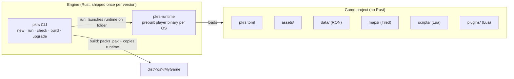
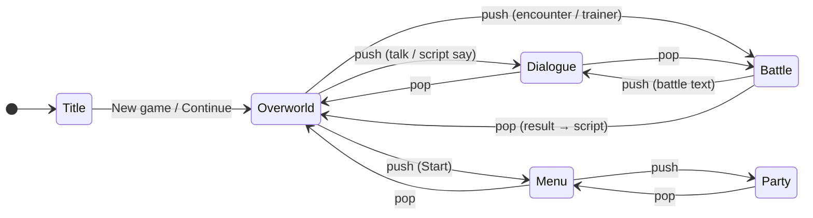
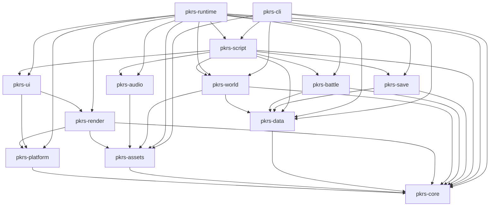
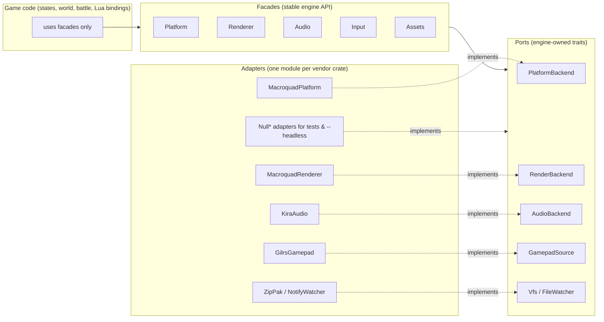
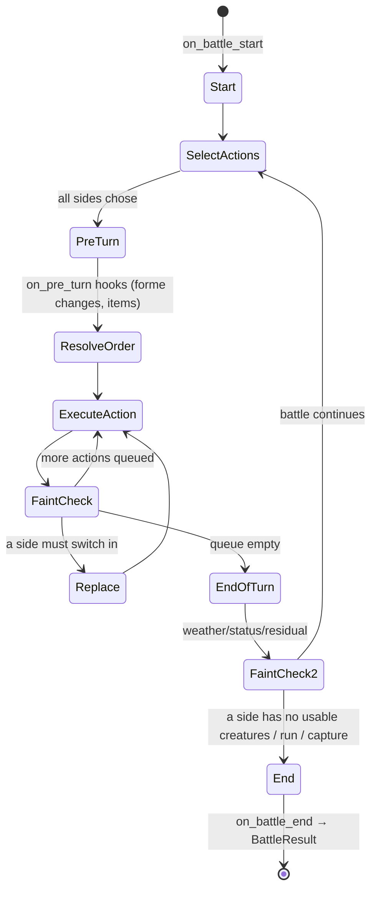

# pkrs — Engine Design Document (MVP v1)

> Status: **Approved** (see [Review & sign-off](#review--sign-off)) · Tracks issue [#1](https://github.com/umbertocicciaa/pkrs/issues/1)
>
> This document settles the architecture of `pkrs` before code is written. Each section is meant
> to be cut directly into implementation issues (see [§16 Roadmap](#16-roadmap--milestones)).

## Decisions at a glance

| Topic | Decision |
|---|---|
| Base stack | **macroquad** (window, loop, 2D rendering) + **kira** (audio) + **gilrs** (gamepad) |
| Architecture | **Game state stack + plain structs** (no ECS) |
| External dependencies | **Ports & Adapters + Facade**: every third-party runtime crate sits behind an engine-owned trait (port), implemented by an adapter, and exposed to game code through a subsystem facade (see [§4.5](#45-external-dependency-isolation-ports-adapters--facades)) |
| Workspace | **Multiple focused crates** (see [§4.3](#43-crate-layout)) |
| Data format | **RON** via `serde` |
| Maps | **Tiled** (`.tmx`) via the `tiled` crate |
| Scripting | **Lua 5.4, vendored**, embedded via `mlua` |
| Plugin hooks | **Priority-ordered chain**: handlers can modify values and cancel events |
| Versioning | **Semver engine** pinned in `pkrs.toml` + separate integer **scripting API level** |
| Internal resolution | **Per project**, default **240×160**, integer-scaled and letterboxed |
| Saves | **RON with a version header**, step-by-step migrations, write-temp-then-rename |
| Distribution | **Prebuilt runtime per OS + a single `.pak` archive** per game, no Rust toolchain needed |
| v1 platforms | **Linux, Windows, macOS only** (WASM dropped for v1; **Android** is a post-v1 target, e.g. handhelds) |
| Shaders (v1+) | **Data-driven custom materials** on tiles/sprites (animated tiles, day/night tints, translucent water) via a small shader/material API in `pkrs-render` |
| Plugins (v1) | **Lua only**; **native Rust plugins** are a planned extension for authors who want performance or engine-adjacent hooks |
| Multiplayer | **Out of scope for v1**, but battle/world/save boundaries are shaped so a future **listen-server or dedicated server** binary can share verification and replay rules |

---

## 0. Build vs. reuse

The first question: *what do we actually need to build?*

### 0.1 Candidates

| Option | What we get | What we'd still build | Verdict |
|---|---|---|---|
| **Bevy** (ship pkrs as a Bevy plugin set) | Renderer, ECS, asset server, audio, input, hot reload, large ecosystem | Game layer, Lua bridge | ❌ ECS-first design is overkill for a turn-based game with few entities. Frequent breaking releases mean constant migration churn for every pkrs game. Heavy compile times. Bridging Lua into Bevy's scheduler/world borrows is awkward. |
| **macroquad** | Window, main loop, 2D batched rendering, render targets, textures, basic input, file loading, GLSL materials | Game layer, audio (via kira), gamepad (via gilrs), custom shader pipeline (§5.6) | ✅ **Chosen.** |
| **ggez** | Similar to macroquad, built on wgpu | Same as macroquad | ❌ Slower release cadence. No clear advantage over macroquad for this genre. |
| **winit + wgpu + kira** | Maximum control | Everything: sprite batcher, render pipeline, text, texture management | ❌ Most code for the least gain. A GBA-style renderer doesn't need custom GPU pipelines in v1. |

### 0.2 Why macroquad

- **Matches the genre.** Pixel-perfect 2D at a tiny internal resolution needs a render target, nearest-neighbour filtering and a batched `draw_texture_ex`. macroquad gives us exactly that.
- **Cross-platform with no system deps.** Builds on Linux, Windows and macOS with plain `cargo build` (plus the usual X11/ALSA dev headers on Linux). v1 targets desktop only; mobile (Android) is evaluated after the desktop MVP is stable.
- **Small surface.** Fast compile times and an API that is easy to wrap behind our own traits.
- **We own the game layer**, which we need anyway: state stack, grid movement, battles and scripting are all pkrs-specific.

Supplements:
- **kira** for audio. macroquad's audio is minimal: no crossfades, tweens or clock-synced transitions. We disable macroquad's `audio` feature.
- **gilrs** for gamepads. macroquad has no gamepad support, and gilrs is polled once per frame alongside macroquad's keyboard state.

### 0.3 What we'd lose by switching later

macroquad, like every other third-party runtime dependency, sits behind engine-owned **ports** (traits) implemented by **adapters** and exposed through subsystem **facades** (§4.5). Game code, Lua and battle logic never touch macroquad types. A later move to wgpu/winit (e.g. for shaders, or multi-window tooling) would then cost:
- Writing new adapters for the `PlatformBackend` and `RenderBackend` ports (window, loop, sprite batch, render target, materials).
- Writing a new file I/O adapter used by `pkrs-assets` (already routed through our own VFS, so this is small).
- **Not** the facades, the state stack, world, battle, scripting, data or save code, nor the main loop in `pkrs-runtime`, which only talks to the `Platform` facade.

Known macroquad limitations we accept for v1: a **global context** (single window, main-thread only). Shader flexibility is limited compared to raw wgpu, but macroquad's material system is enough for v1 custom tile/sprite effects; we wrap it behind our own material API so a backend swap does not rewrite game projects (§5.6).

### 0.4 Lua compatibility check

- `mlua` with features `lua54` + `vendored` compiles the Lua C sources with `cc`. That works on Linux (gcc/clang), Windows (MSVC) and macOS (clang) with no system Lua.
- mlua and macroquad don't interact. The Lua state lives on the main thread (macroquad is main-thread anyway), so we **don't** need mlua's `send` feature.
- **Desktop-first:** vendored Lua + macroquad is validated on Linux, Windows and macOS. **WASM is not a v1 target** (dropped; see §17). **Android** may reuse the same runtime later with a different platform backend; we avoid design choices that assume web-only or single-player-only forever.

### 0.5 Engine vs. game project split



- **Engine** = Rust code: the `pkrs` CLI plus the `pkrs-runtime` player binary. It's installed once (e.g. `cargo install pkrs-cli`, or a downloaded release), and the CLI fetches and caches prebuilt runtimes per OS and version.
- **Game project** = data only: TOML, RON, Tiled maps, images, audio and Lua. **Making a game never requires a Rust toolchain.**
- Anything a game needs that the engine doesn't provide is added through **Lua plugins** (§9), never by forking the engine.

---

## 1. Scope & non-goals

### 1.1 In scope (v1)
- **Genre:** Gen 1–3 style creature-collecting RPGs (GBA-era feel), single-player.
- **Platforms (required for v1):** Linux (x86_64), Windows (x86_64), macOS (x86_64 + arm64).
- **Platforms (post-v1, planned):** Android (e.g. ARM64 handhelds). WASM and other targets are not planned for the first release.
- **Game size:** the same engine handles everything from a **one-shot story** (one map, a handful of scenes, maybe no battles) to a **full fan game** (multiple regions, full creature roster, story, post-game).
- Top-down tile overworld, grid movement, turn-based 1v1 battles (with doubles possible as a plugin later), menus, dialogue, data-driven content, Lua scripting and plugins, saves.

### 1.2 Non-goals for v1
- 3D rendering or perspective cameras (see §1.4 for how we avoid blocking a far-future 3D map mode).
- **Playable multiplayer** (online battles, trading, co-op overworld). v1 is single-player only, but §4.4 records the constraints we follow so multiplayer does not require a rewrite later.
- An **in-engine editor GUI**. v1 uses **Tiled** for maps and plain text editors for RON/Lua. The asset pipeline and map format are chosen so an internal editor can replace Tiled later without breaking projects.
- **In-engine data authoring** (visual editors for moves, abilities, species, …). Content stays in RON files for v1.
- Mobile and console targets in v1 (Android is explicitly **post-v1**, not abandoned).
- **Native-Rust plugins** in v1. Plugins ship as **Lua** only; Rust dynamic plugins are a later, optional path for advanced authors (§9.9).
- Shipping any third-party franchise IP (names, characters, sprites, music, data or trademarked mechanic names). See §1.3.

### 1.3 IP policy
The engine is generic. The repo contains **no** third-party franchise names, trademarks, sprites, music or data, and the docs do not name any commercial creature-collecting franchise. Engine terminology is neutral ("creature", "species", "move", "trainer"). Templates and demo projects use original or CC-licensed assets, with licenses recorded in each asset folder (`LICENSES.md`).

### 1.4 Long-term product direction (avoid technical debt)

v1 is **write-oriented**: authors edit Tiled maps, RON data and Lua in external tools. Long term, pkrs should become **click-oriented** as well: integrated (or bundled) tooling for maps, encounters, dialogue flow and game data, without forcing everyone off text files on day one.

Design rules so that future does not fight v1:

| Future capability | What we do in v1 |
|---|---|
| **Internal map editor** (replace Tiled) | Keep Tiled as interchange: load/save `.tmx`/`.tsx`, document layer/property conventions in code (`pkrs-world`), store no editor-only secrets in the binary map model. |
| **3D / perspective maps** (far future) | Map model separates **logical grid** (collision, warps, encounters) from **visual layers**. v1 visuals are 2D tiles; logical data stays backend-agnostic. |
| **Game data editor** | RON schemas in `pkrs-data` are the source of truth; validation is shared by `pkrs check` and runtime. A future GUI is a front-end on the same schemas, not a parallel format. |
| **Click-first workflows** | CLI and file layout stay stable; future UI generates the same `pkrs.toml`, `data/`, `maps/` tree. |

---

## 2. Project model & `pkrs` CLI

### 2.1 Project layout

```
my-game/
  pkrs.toml          # manifest (see 2.2)
  assets/
    sprites/         # PNG sprite sheets + optional .ron animation descriptors
    tilesets/        # PNG + Tiled .tsx
    audio/bgm/       # OGG
    audio/sfx/       # OGG/WAV
    fonts/           # bitmap fonts (PNG + .ron glyph metrics) or BMFont .fnt
    ui/              # window skins, cursors, icons
    shaders/         # optional GLSL for custom tile/sprite materials (§5.6)
  data/
    species/*.ron
    moves/*.ron
    items/*.ron
    abilities/*.ron
    types.ron        # type chart
    trainers/*.ron
    encounters/*.ron
    text/<lang>/*.ron   # dialogue/strings (localizable)
  maps/
    *.tmx            # Tiled maps
    world.ron        # map connections (or Tiled .world file)
  scripts/
    main.lua         # optional game-level init (new game setup, global events)
    maps/<map>.lua   # per-map events
    cutscenes/*.lua
  plugins/
    <plugin-name>/
      plugin.toml
      init.lua
      ...
  saves/             # dev-only saves when using `pkrs run` (git-ignored)
```

Every folder except `pkrs.toml` is optional, so a one-shot story can contain just a map, a tileset, a sprite sheet and one script.

### 2.2 `pkrs.toml`

```toml
[game]
name        = "Lighthouse Tale"
id          = "com.example.lighthouse"   # used for save/config paths and the macOS bundle id
version     = "0.1.0"
authors     = ["Jane Doe"]

[engine]
version     = "0.3"          # semver requirement on the engine/runtime
api         = 1              # scripting API level the game scripts target

[display]
width       = 240            # internal resolution (default 240x160)
height      = 160
scale       = 3              # initial window scale
fullscreen  = false

[start]
map         = "lighthouse_1f"
position    = [5, 7]
facing      = "down"
script      = "scripts/main.lua"   # optional

[features]                   # engine subsystems the game uses
battles     = true           # false for pure story games, which skips loading battle data
party       = true

[plugins]
enabled     = ["resonance", "day-night"]   # load order hint; final order is resolved (§9.4)

[locale]
default     = "en"
available   = ["en", "it"]

[input]                      # default bindings (§10): action = [key names]; players rebind per-user (§14.3)
confirm     = ["z", "enter"]
cancel      = ["x", "backspace"]
"resonance:toggle" = ["r"]   # plugin actions are namespaced `plugin:action`
```

**Loading & validation (`pkrs_core::manifest`).** The manifest model lives in `pkrs-core` so the runtime and the CLI share it. Loading has two stages: (1) TOML parsing, value types and unknown keys (typos are errors), reported with the field path and line/column; (2) validation of ranges, id formats and semver, which reports *every* problem at once, each with its dotted field path (`display.scale`, `plugins.enabled[1]`). Only `[game]` (`name`, `id`), `[engine]` (`version`, `api`) and `[start]` (`map`, `position`) are required. Defaults: `game.version = "0.1.0"`, `display` 240×160 at scale 3 windowed, `start.facing = "down"`, all `features` on, no plugins, `locale.default = "en"` with `available = [default]`, no `[input]` overrides. Rules: `game.id` is dot-separated ASCII segments; `engine.api ≥ 1`; `display.width/height` in 1–4096 and `scale` in 1–16; `start.map` is a content id; `start.position` is non-negative; `start.script` is a project-relative `.lua` path with no `..`; plugin ids are lowercase with `_`/`-`; locale tags are BCP-47-style and `available` must contain `default`; lists have no duplicates.

### 2.3 CLI commands

| Command | Purpose |
|---|---|
| `pkrs new <name> [--template one-shot\|battle\|full-game]` | Scaffold a project from an embedded template. Pins `engine.version` to the CLI's version. |
| `pkrs run [--release] [--map <id>] [--warp x,y]` | Run the project from loose files with dev features: script hot-reload, debug overlay (F3), verbose logs. |
| `pkrs check [--plugins] [--deny-warnings]` | Validate `pkrs.toml`, all RON data (schema + cross-references), Tiled maps (required layers/properties), Lua syntax, plugin manifests and dependency graph. `--plugins` also loads the plugins and prints the resolved hook table (§9.4). Non-zero exit on errors, so it's CI-friendly. |
| `pkrs build --target <linux\|windows\|macos\|all> [--out dist/]` | Run `check`, pack the project into `game.pak`, then fetch the matching **prebuilt runtime** and assemble a distributable (§14). Works from any host OS. |
| `pkrs upgrade [--to <version>]` | Bump `engine.version`, run project migrations (e.g. renamed manifest keys), and report scripting-API deprecations. |
| `pkrs plugin new <name>` | Scaffold a plugin folder with a manifest and hook examples. |

### 2.4 Templates
- **one-shot**: one small map, the player, two NPCs, a cutscene with dialogue and choices, an ending screen. `features.battles = false`. Shows that no battle data is required.
- **battle**: a battle playground. One arena map whose `scripts/main.lua` starts a trainer battle on `game_start`, so `pkrs run` opens straight into the battle; afterwards the player can ask for a rematch or talk to the rival. Ships editable battle data (`data/types.ron`, moves, three species, the player's party and the rival) and a `tests/battle.lua` scenario.
- **full-game**: two connected maps plus an interior, a starter-selection script, three original species, eight moves, a type chart, items, one trainer battle, wild encounters, a party/bag/save menu and one example plugin.

Templates are embedded in the CLI binary with `include_dir`, so `pkrs new` works offline.

**Implementation notes (M2).** Templates live in `crates/pkrs-cli/templates/<name>/`. Text files (`.toml`, `.md`, `.lua`, `.txt`, `_gitignore`) get `{{name}}`, `{{id}}` (`com.example.<slug>`) and `{{engine_version}}` (the CLI's own version) substituted, and `_gitignore` is written as `.gitignore` (it ignores `saves/` and `dist/`). The v1 `one-shot` template is one 20×14 map with original CC0 art, a player sprite and `LICENSES.md`; the full story content ships with M8, and `full-game` is rejected until then. `pkrs run` finds the nearest `pkrs.toml` upwards, launches `$PKRS_RUNTIME` or the `pkrs-runtime` next to the `pkrs` executable (downloads are M7), and forwards `--project <dir> [--map <id>] [--warp x,y] [--headless] [--ticks N]`. The runtime checks `engine.version` and `engine.api`, mounts the folder through `FolderVfs`, loads `maps/<map>.tmx`, and writes dev saves under `<project>/saves/`. Until grid movement lands (§6.3), the runtime moves the player one tile per held direction, respecting collision.

### 2.5 Engine version pinning & upgrades
- `engine.version` is a semver requirement. `pkrs run`/`build` pick the newest installed or downloadable runtime that satisfies it.
- While pkrs is `0.x`, minor bumps may break things. From 1.0, normal semver applies.
- `engine.api` (scripting API level) is **independent** of engine semver. See §9.7.
- `pkrs upgrade` is the only command that edits `pkrs.toml`. It prints a changelog of anything that needs manual attention.

---

## 3. Core loop & time

### 3.1 Fixed timestep (*Fix Your Timestep*)

The windowing backend (macroquad in v1) drives the outer loop, but `pkrs-runtime` only sees the `Platform` facade (§4.5). Inside it we run a fixed-step accumulator:

```rust
const DT: f64 = 1.0 / 60.0;          // simulation tick (60 Hz, matches GBA-era timing)
const MAX_FRAME: f64 = 0.25;         // clamp: avoid the "spiral of death" after a stall

let mut acc = 0.0;
loop {
    let frame = platform.frame_time().min(MAX_FRAME);
    acc += frame;

    input.poll(&mut platform);       // keyboard + gamepad adapters, once per rendered frame
    while acc >= DT {
        input.begin_tick();          // edge detection is per tick (pressed/released)
        game.update(DT, &mut ctx);   // state stack, scripts, world, battle
        acc -= DT;
    }
    let alpha = acc / DT;            // interpolation factor
    game.render(alpha, &mut renderer);
    platform.next_frame().await;
}
```

- **Logic runs at exactly 60 Hz** regardless of display rate, so walk speed, animation timing and script `wait(frames)` are deterministic.
- **Rendering interpolates** positions between the previous and current tick with `alpha`. Each movable thing stores `prev_pos` and `pos`. This keeps 120/144 Hz displays smooth.
- Script waits are expressed in **ticks** (`wait(30)` = half a second), never in wall-clock time.

### 3.2 Frame pacing
- VSync on by default (macroquad's default swap interval). A config option allows an uncapped frame rate for debugging.
- Slow frames: accumulated time is clamped to `MAX_FRAME`, so the game slows down instead of running dozens of catch-up ticks.
- The window losing focus pauses the simulation (configurable) and ducks audio.
- Policy lives in the `Platform` facade (`pkrs-platform`): `frame_time()` is clamped to `MAX_FRAME` and reports `0` while paused by focus loss (`PlatformConfig::pause_on_focus_lost`), and focus changes surface as `PlatformEvent::FocusLost` / `FocusGained`. The macroquad adapter derives focus from miniquad's minimize/restore events, which fire on focus changes on X11, macOS and wasm; **miniquad does not report focus on Windows**, so there the window is treated as always focused until the adapter gains a native hook.

### 3.3 Deterministic update order
Within a tick:
1. Input → action state (§10).
2. Script scheduler: resume coroutines whose wait conditions are met (§9.3).
3. State stack: `top.update(ctx)`. Lower states only receive `update_background` if they opt in (e.g. overworld water animation under a dialogue box).
4. Deferred state transitions (push/pop/replace) are applied **after** the update, never mid-update.
5. Event queue flush: engine events are dispatched to Lua listeners in emission order.
6. Audio commands are flushed to the `AudioBackend` port (kira adapter in v1).

The game RNG is a seeded `rand_pcg::Pcg64` stored in the save. Battles get their own sub-seed (§7.2).

---

## 4. Architecture

### 4.1 State stack + plain structs (no ECS)

**Justification:** a creature-collecting RPG has a few dozen entities per map at most, its logic is overwhelmingly **modal** (overworld, battle, menu, dialogue), and battles are turn-based. ECS strengths (cache-friendly iteration over thousands of entities, parallel systems) don't pay off here, while ECS costs (indirection, borrow juggling, opaque data for Lua) do. Plain structs map 1:1 to Lua userdata and to save data.

```rust
pub trait GameState {
    fn id(&self) -> &'static str;
    fn on_enter(&mut self, ctx: &mut Ctx) {}
    fn on_exit(&mut self, ctx: &mut Ctx) {}
    fn on_resume(&mut self, ctx: &mut Ctx) {}          // the state above it was popped
    fn update(&mut self, ctx: &mut Ctx) -> Transition;
    fn update_background(&mut self, _ctx: &mut Ctx) {} // opt-in, when not on top
    fn render(&self, r: &mut Renderer, alpha: f32);
    fn is_opaque(&self) -> bool { true }                // false: render states below first
}

pub enum Transition { None, Push(Box<dyn GameState>), Pop, Replace(Box<dyn GameState>), PopTo(&'static str), Quit }
```



- **Input and update are routed to the top state only.** Rendering walks down to the nearest opaque state, then draws upward, so a dialogue box draws over the overworld.
- Built-in states: `Title`, `Overworld`, `Dialogue`, `Choice`, `Menu`, `Party`, `Bag`, `Summary`, `Battle`, `Transition` (fades and wipes), `SaveScreen`.
- **Lua-defined states:** plugins can register new UI screens as states (§9.5). They implement the same lifecycle through a Lua table.

### 4.2 Shared context
`Ctx` is a struct of borrowed services handed to each state: `assets`, `audio`, `input`, `script`, `data` (immutable content database), `world_state` (flags, variables, party, bag: the save-relevant state), `rng`, `events` (queue). Each service is a **facade** (§4.5); none of them exposes a third-party type. There are **no globals**, apart from the macroquad context, which stays hidden inside the macroquad adapters of `pkrs-platform` and `pkrs-render`.

### 4.3 Crate layout

As decided, a multi-crate workspace. Each crate exists to enforce a **dependency boundary**, and the justification is listed per crate.

```
crates/
  pkrs-core       # shared types: ids, Direction, GridPos, Ctx traits, events, errors, GameRng port
  pkrs-platform   # Platform facade + ports (window, loop, keyboard, gamepad, file I/O, user paths); macroquad/gilrs/directories adapters
  pkrs-assets     # Assets facade: VFS (loose folder | .pak), handles, caching; zip + notify adapters
  pkrs-data       # RON schemas (species, moves, items…), loading, validation, cross-ref checks
  pkrs-render     # Renderer facade + RenderBackend port: render target, sprite batch, atlases, layers, camera, text, materials; macroquad adapter
  pkrs-audio      # Audio facade + AudioBackend port: BGM/SFX, crossfades, ducking; kira adapter
  pkrs-world      # map model, collision, grid movement, warps, connections, NPCs; MapImporter port + Tiled adapter
  pkrs-battle     # PURE battle logic: no macroquad, no mlua, no I/O; deterministic & unit-tested
  pkrs-script     # mlua runtime, sandbox, Lua API bindings, coroutine scheduler, plugin loader
  pkrs-save       # save model, versioning, migrations, atomic writes, per-OS paths
  pkrs-ui         # state-stack UI states: dialogue, menus, window skins (uses render + input)
  pkrs-runtime    # BINARY: the game player; wires everything; state stack; main loop
  pkrs-cli        # BINARY: `pkrs` command: new/run/check/build/upgrade/plugin
```



Key boundaries:
- **`pkrs-battle` must not depend on macroquad, mlua or any I/O.** It exposes a `BattleHooks` trait, and `pkrs-script` implements that trait by calling Lua. Pure logic stays unit-testable and deterministic.
- **Every third-party runtime crate is imported by exactly one owning crate**, and only inside its adapter module (§4.5). Only `pkrs-platform` and `pkrs-render` import macroquad, which keeps a future backend swap small (§0.3).
- `pkrs-cli` reuses `pkrs-data`, `pkrs-world` and `pkrs-script` for `pkrs check` (it parses Lua without running the game).
- **`pkrs-runtime` depends on `pkrs-battle` and `pkrs-data` (M4, battle UI).** The `Battle` state steps the pure battle logic and plays its events back, and it builds battles from the project's `data/`, so the runtime (which wires everything) uses both crates directly. `pkrs-ui` stays free of battle types: the battle screen lives in `pkrs_runtime::battle` and uses `pkrs-ui`'s dialogue, choice and window-skin components (§7.2 notes).
- **`pkrs-ui` depends only on `pkrs-render` and `pkrs-platform` (§4.3).** Vertical menus expose `MenuCursorDirection` (Up/Down) from `pkrs-platform` so choice lists do not add a `pkrs-core` edge; `Input::menu_direction` still returns `pkrs_core::Direction` for movement-aware callers. Runtime dialogue/choice overlays accept a shared `UiTheme` (font handle + `WindowSkin`) from the caller instead of uploading textures inside each state.

### 4.4 Multiplayer-ready boundaries (future, not v1)

Multiplayer is not implemented in v1, but core crates are shaped so a later milestone can add:

- **`pkrs-server` (future binary):** authoritative simulation for linked battles (and eventually overworld sync). Built from the same `pkrs-battle` + `pkrs-world` logic as the client, with no macroquad/mlua in the hot path unless hooks are explicitly enabled.
- **Client modes:** **host** (embedded listen server + local player) or **connect** to a remote server process. Games ship the client runtime only; server is an optional second binary produced by `pkrs build --server` (exact packaging TBD).
- **Integrity & verification:** battles use a **deterministic event log** (`BattleEvent` stream + inputs + config hash). Two peers (or a spectator) can re-run the same seed and inputs to verify outcomes. Single-player uses a **local RNG policy**; networked battles use a **authoritative server RNG policy** (§7.2) so replays and anti-cheat rules are defined once.
- **Save model:** overworld flags/variables and per-map event state remain in the save (§6.5); server authoritative state for battles is separate from the long-lived save file.

### 4.5 External dependency isolation (Ports, Adapters & Facades)

**Decided:** third-party crates are wrapped with the **Ports & Adapters** pattern (hexagonal architecture), combined with a **Facade** per subsystem. This is the standard way to keep an engine core independent of vendors: GoF *Adapter* converts a library's interface into the one the engine expects, GoF *Facade* gives game code a small, stable entry point over a whole subsystem, and the *port* (an engine-owned trait) is what makes adapters swappable and testable (*Dependency Inversion*).



**Roles:**
- **Port** — a trait owned by pkrs, expressed in engine vocabulary only (`TextureId`, `SoundId`, `GridPos`, our error enums). It defines the *minimum* the engine needs from a backend, not a mirror of the vendor API.
- **Adapter** — implements one port on top of one vendor crate (`MacroquadRenderer: RenderBackend`, `KiraAudio: AudioBackend`, …). It lives in a `backend/<vendor>.rs` module of the owning crate, behind a cargo feature, and is the **only** place that vendor's types appear. It converts vendor errors into the crate's `thiserror` enum.
- **Facade** — the public, game-facing service (`Renderer`, `Audio`, `Input`, `Assets`, `Platform`) that holds a port implementation and adds engine policy on top: batching, layers and pixel-perfect scaling in `Renderer`; crossfades, ducking and the per-tick command queue in `Audio`; action mapping and buffering in `Input`. These facades are what `Ctx` hands to states (§4.2) and what the Lua API binds to (§9.1).
- **Null adapters** — `NullRenderer`, `NullAudio`, `NullGamepad`, `MemoryVfs` implement the same ports, giving headless CI and unit tests for free (§15.2, §17 #8).

**Dependency map (v1):**

| Vendor crate | Port | Adapter | Facade seen by game code | Owning crate |
|---|---|---|---|---|
| `macroquad` (window, loop, keyboard, file I/O) | `PlatformBackend` | `MacroquadPlatform` | `Platform`, `Input` | `pkrs-platform` |
| `macroquad` (GL, textures, materials) | `RenderBackend` | `MacroquadRenderer` | `Renderer` | `pkrs-render` |
| `gilrs` | `GamepadSource` | `GilrsGamepad` | `Input` | `pkrs-platform` |
| `directories` | `UserPaths` | `DirectoriesPaths` | `Platform::paths()` | `pkrs-platform` |
| `kira` | `AudioBackend` | `KiraAudio` | `Audio` | `pkrs-audio` |
| `zip` | `Vfs` | `PakVfs` (and `FolderVfs`) | `Assets` | `pkrs-assets` |
| `notify` | `FileWatcher` | `NotifyWatcher` | `Assets` hot reload | `pkrs-assets` |
| `tiled` | `MapImporter` | `TiledImporter` | `pkrs-world::Map` model | `pkrs-world` |
| `mlua` | `BattleHooks` (from `pkrs-battle`) + `ScriptHost` | `LuaScriptHost`, `LuaBattleHooks` | `ScriptHost` | `pkrs-script` |
| `rand_pcg` | `GameRng` | `Pcg64Rng` | `ctx.rng` | `pkrs-core` |
| `toml` | manifest codec in `pkrs-core` | `manifest::toml_codec` | `ProjectManifest`, `PluginManifest` | `pkrs-core` |
| `semver` | — (engine newtypes) | `Version`, `VersionReq` | `ProjectManifest.engine`, plugin versions (§9.4) | `pkrs-core` |
| `ron` | codec functions in `pkrs-data` (`codec.rs`) / `pkrs-save` / `pkrs-audio` (`codec.rs`, audio manifest); sprite animation descriptors in `pkrs-render` | `RonCodec`; `parse_animation_descriptor` | typed structs, `pkrs_save::Value`; `SpriteSheetAnimation` | `pkrs-data`, `pkrs-save`, `pkrs-render`, `pkrs-audio` |
| `texture_packer` | `AtlasPacker` | `TexturePackerAdapter` | `pkrs build` pipeline | `pkrs-cli` |

**Not wrapped (allowed directly), and why:** `serde` (derive framework; it *is* the abstraction), `serde_path_to_error` (serde helper that only adds the failing field path to errors; never in public APIs), `thiserror` (compile-time only), `tracing` (already a logging facade), `anyhow`, `miette` (only in `pkrs-cli`'s `report.rs` adapter, which renders the engine's own `Diagnostic` model; `deny.toml` lists it as wrapped by `pkrs-cli`), `include_dir` (binaries only, never in library APIs), `clap` (CLI argument parsing in the `pkrs` binary only), `insta` (dev-only). Adding a new crate to this list requires a note in this section.

**Rules:**
1. **No vendor type in any public signature** of a pkrs library crate. Facades and ports use engine types only.
2. **One owning crate per vendor crate**, enforced in CI with `cargo deny` `[bans]` using `wrappers = [...]` (e.g. `macroquad` may only be a dependency of `pkrs-platform` and `pkrs-render`).
3. **Ports are minimal and engine-shaped.** Grow them when a feature needs it; never expose a vendor feature "just in case".
4. **One backend per build**, selected by cargo feature. Facades store the port as `Box<dyn Port>`: call counts are low (hundreds per frame, sprite draws are batched inside the adapter), so dynamic dispatch is acceptable; revisit with profiling, not upfront.
5. **Swapping a vendor = writing an adapter.** No change to facades, game code, Lua API or project files.

---

## 5. Rendering

### 5.1 Pixel-perfect output
- All game rendering goes to a **render target** of `display.width × display.height` (default 240×160) with `FilterMode::Nearest`.
- The final blit to the window uses the **largest integer scale** that fits, centered, with **letterbox** bars (color configurable). An optional "fit" mode (non-integer, still nearest) is available for fullscreen on odd displays.
- Camera positions are rounded to whole internal pixels when drawing, while the interpolated value is kept for smoothness. This avoids sub-pixel shimmer.
- The UI is drawn into the same target at native resolution, so text is pixel-crisp.

### 5.2 Sprites, atlases, batching
- macroquad already batches draw calls that share a texture. We maximize this by packing sprites into **texture atlases**:
  - Dev (`pkrs run`): images are loaded individually. Simple, and supports hot reload.
  - Release (`pkrs build`): the packer builds atlases per category (characters, tilesets, UI) through the `AtlasPacker` port (`texture_packer` adapter, §4.5) and stores rects in the `.pak` index.
- **Layers** (draw order): `Ground → GroundDecor → Entities (y-sorted) → Overhead → Weather/FX → UI → Transition`.
- **Y-sorting:** entities in the `Entities` layer are sorted by their feet Y (tile row, then sub-pixel offset), then by a stable id to avoid flicker.

### 5.3 Camera
- Follows the player's interpolated position, centered on the player tile.
- Clamped to map bounds unless the map is smaller than the screen, in which case it's centered. Connected maps (§6.4) extend the clamp region so walking across a seam doesn't jerk the camera.
- Scriptable: `camera.pan_to(x, y, ticks)`, `camera.follow(npc)`, `camera.shake(...)`.

### 5.4 Sprite animation
- Animation descriptor (RON) per sheet: frame size, and named clips with frames + ticks per frame + loop flag.
- **Direction-aware** clips (`walk_down`, `walk_up`, `walk_left`, `walk_right`; `right` may mirror `left` via `flip_x`).
- Grid walk cycles are synced to movement: one step = half a walk cycle, alternating feet.

### 5.5 Text
- **Bitmap fonts:** BMFont `.fnt` (text format) or our own RON glyph map. Variable-width glyphs are supported. *We build this ourselves because macroquad's TTF rendering blurs at low resolution; a bitmap font renderer is about 200 lines.*
- Dialogue box features: typewriter reveal (configurable speed), inline control codes (`{color:red}`, `{pause:20}`, `{player}`, `{var:rival_name}`), auto-wrap to box width, page breaks, and a "more" arrow.
- All text goes through the localization table (`data/text/<lang>/`).

**Implementation notes (localization tables and text keys, M6).**
- **Tables and lookup.** Text tables are the §8.1 `data/text/<lang>/*.ron` maps (`TextDb::load_dir`). `pkrs_data::Localizer` holds `[locale] default / available`, the active language and an ordered list of `TextDb` layers: the game's `data/text/`, each plugin's `plugins/<id>/data/text/` (load order), then the engine's own table. A key is looked up in the active language, then the default language, then English; within a language the layers are tried in order, so a game overrides an engine text by defining its key. A `text:` key that no table defines is shown verbatim in dialogue (`text:keeper.hello`) and readable in battle (`keeper.hello`), so the problem stays visible.
- **Arguments.** Texts take `{name}` placeholders filled from named arguments and `{0}`, `{1}`, … from positional ones (`pkrs_data::TextArgs`, `format_text`). A placeholder without a matching argument is kept, so dialogue control codes (`{player}`, `{color:red}`, `{{`) pass through. Lua passes them as a table: `ui.say("text:guide.hello", { town = "Borgo" })`, `{ "Ash" }` for `{0}`; values are strings, numbers or booleans.
- **Where text is localized.** Dialogue, choice prompts and options (`ui.say/choose/yes_no/notify`, sign `text`) are localized when the request is queued by the runtime's `ScriptWorld`; `ui.yes_no` uses the engine keys `ui.yes` / `ui.no`. Battle screens get a `BattleText` (localizer plus the content database's `name` fields) when they open: every message, menu label, prompt and post-battle text is an engine key (`crates/pkrs-runtime/text/<lang>/engine.ron`, shipped in English and Italian); hook messages `ctx.message("text:…", args)` carry their arguments in `BattleEvent::Message { key, args }`. Content names resolve their `name` field, else the `<kind>.<id>` key (`moves.ember`, `items.potion`, `species.leafkit`, `statuses.burn`), else a readable form of the id. Creature names in battle are the localized species name at the time the battle opens (until nicknames land).
- **Switching.** `game.language()`, `game.languages()`, `game.set_language(lang)` (only declared languages) and `game.text(value, args?)` are the script options API; `ProjectHost::language()` / `set_language()` the engine side (for an options menu). After a switch every text shown from then on uses the new language; a text box already open keeps its text. The chosen language is not saved yet (the save system, §12, will persist it with the player options). Scenarios read it with `language()`.
- **Missing keys.** `TextDb::lookup` / `TextLookup::Missing` and `Localizer::has_key` give `pkrs check` what it needs to report keys used by content and scripts that a language lacks; the report itself belongs to the validation work (§8.2).

### 5.6 Custom shaders & materials (creators)

Authors need effects that plain blitting cannot express: **animated tiles** (e.g. flickering lanterns), **day/night colour cycling**, **translucent water**, simple palette swaps. v1 exposes this through **materials**, not raw engine internals:

- **Tile/sprite materials** reference a small built-in shader library (`pkrs/shaders/*.glsl` in the engine) or a **project shader** under `assets/shaders/` (loaded via VFS, validated by `pkrs check`).
- **Material descriptor (RON)** on a tileset, layer, or sprite: `shader`, `uniforms` (scalars, colours, time-driven flags), optional `atlas_region` for multi-tile animations.
- **Uniforms:** engine provides `time_ticks`, `map_origin`, and plugin-registered globals (e.g. day-night phase from a plugin). No arbitrary GPU code from Lua in v1; Lua sets parameters, Rust/materials apply them.
- **API surface:** `render.set_global_uniform(name, value)` from Rust hooks; plugins use Lua wrappers. Custom shaders must declare a **capability profile** (max uniforms, texture slots) so `pkrs check` can reject unsupported combinations.
- **Backend note:** implemented by the `MacroquadRenderer` adapter using macroquad materials in v1; exposed only as `pkrs-render::Material` through the `RenderBackend` port (§4.5), so a wgpu adapter later reuses the same descriptors.

---

## 6. World & maps

### 6.1 Tiled as the map editor (v1)
- Maps are authored in **Tiled** and loaded by the `TiledImporter` adapter (built on the `tiled` crate) into the engine's own map model through the `MapImporter` port (§4.5) (`.tmx` + `.tsx`). No in-engine editor in v1; formats and layer conventions are stable so a future pkrs map editor can read/write the same files (§1.4).
- `pkrs check` validates engine conventions (required layers, property types).
- `.tmj` (JSON) support depends on the `tiled` crate version. See §17.

### 6.2 Layer conventions

| Tiled layer | Kind | Meaning |
|---|---|---|
| `ground`, `ground2…` | Tile layer | Drawn below entities |
| `overhead` | Tile layer | Drawn above entities (tree tops, roofs) |
| `collision` | Tile layer (special tileset) or tile property `solid=true` | Blocked tiles; directional blocking via `block_n/s/e/w` |
| `terrain` | Tile property `terrain=` | `grass`, `water`, `ledge_s`, `ice`, `tall_grass`, … → movement rules + encounter type |
| `objects` | Object layer | `warp`, `npc`, `trigger`, `sign`, `item`, `spawn` objects with custom properties |
| `encounters` | Object layer (rects) | `table = "route1_grass"`, `rate = 20` |

Object properties reference scripts by name: an `npc` with `script = "maps/route1.lua:old_man"`, a `trigger` with `on_enter = "cutscenes/rival_intro"`.

**Implementation notes (`pkrs_world::conventions`).** `ground` is required and draws in the `Ground` band; `ground2`, `ground3`, … draw in `GroundDecor`. A tile layer named `terrain` is logical only (never drawn). Tile properties `solid`, `block_n/s/e/w` and `terrain` are honoured on **any** tile layer, and later layers override earlier terrain. A tile on the `collision` layer is fully solid unless it only declares `block_*` edges (fences) or says `solid = false`. Directional blocking is checked on both sides of the shared edge. Object classes and their properties: `warp` (`to_map`, `to_x`, `to_y` required; `facing`, `transition`), `npc` (`script`, `sprite`, `facing` = `down`), `trigger` (`on_enter`, `once` = false), `sign` (`script` or `text`), `item` (`item` required, `count` = 1), `spawn` (`facing`); objects may set `uid` as their persistent key (§6.5). Encounter rects need `table` (string) and `rate` (int 0–100). Object pixel rects are converted to whole tiles. Orthogonal, finite maps only; image and group layers are rejected. Importers translate their format into an editor-neutral `RawMap`, so a future pkrs map editor reuses the same convention checks.

### 6.3 Grid movement
- The player and NPCs occupy one tile. A step takes **16 ticks walking** and **8 ticks running** (configurable per project), with position interpolated over the step.
- **Facing:** tapping a direction turns the player without moving (a tap shorter than N ticks only turns), as in classic GBA-era RPGs.
- **Rules evaluated before a step:** bounds/connection → collision (tile + directional) → entity occupancy → terrain rule:
  - `ledge_<dir>`: can only be crossed in that direction, playing a hop animation over 2 tiles.
  - `water`: requires the `surf` field state (granted by a field action, see §9.5).
  - `ice`: forced slide until blocked.
  - Custom terrains: plugins can register terrain rules (`world.register_terrain("mud", rule_fn)`).
  - *Implementation notes (`pkrs_world::TerrainRules`, M5).* The stepper asks a `TerrainRules` port with a `TerrainQuery { terrain, field, from, to, dir }` for every step onto a `Terrain::Custom` tile. `FieldState` holds `surf` plus named states (`plugin_id:state`). The player's rules are, in order: Rust rules on the host's `TerrainRuleRegistry`, then the script host (`LuaScriptHost: TerrainRules`): a Lua rule (`false` or `"block"` blocks; `nil`/anything else or a failing rule allows, failures are logged), then a data-defined `TerrainDef` (`passable`, `requires_field`). NPC scripted paths use the Rust registry only, because they move while the overworld state is borrowed and a Lua rule could call back into it.
- **Step events:** `on_step` fires after each completed step (encounter roll, triggers, step counters for plugins).
  - *Implementation notes (wild encounters, M4).* Tables live in `data/encounters/*.ron` (`pkrs_data::EncounterTable`, one table or a list per file): `id`, optional `terrains` (terrain names the table rolls on; empty means every tile of the rect) and `slots` of `(species, min_level, max_level, weight)`. Validation rejects an empty slot list, levels outside `1..=100` or `min_level > max_level`, a zero weight, weights that overflow `u32`, duplicate table ids and (at load) unknown species. **The per-step rate stays on the rect** (`rate`, percent per step, §6.2); tables carry no rate, so one table can be reused by rects with different rates. **Lookup by tile and terrain** (`pkrs_world::encounter_site`): the rects covering the tile are tried in map order, and the first whose table accepts the tile's terrain is used, so overlapping rects give one area separate grass and water tables. A rect naming an unknown table is a content error (logged once per map, never rolls). **Roll** (`pkrs_world::roll_step_encounter`): after a completed step that does not start a warp, one draw `gen_range(100) < rate`, then a weighted slot pick and a uniform level in its range; a tile without a site draws nothing. The overworld (`pkrs_runtime::encounters::Encounters`) rolls only when no dialogue is open, no battle runs and no script holds the player. Tables load on the first step onto an encounter rect (a failure is logged and turns encounters off). Rolls use their own `Pcg64` stream, seeded with a constant until the save owns the game RNG (§12); scenario runs pin it with the scenario seed. A hit starts the wild battle through the same path as `battle.start_wild` (`BattleContent::prepare`, §7.2) with no script task waiting on it, and play returns to the overworld on the same tile when the battle ends (e.g. after running). The `step` event still fires for that step. Repel-like suppression is left to plugins (no hook for it yet).

### 6.4 Transitions & connections
- **Warps:** `warp` objects specify `to_map`, `to_x`, `to_y` and optional `facing`/`transition` (`fade`, `none`, `door`). Entering one pushes a `Transition` state, swaps the map, then pops.
- **Seamless connections:** `maps/world.ron` (or Tiled's `.world` file) declares `north/south/east/west` neighbours with an offset. The renderer draws the neighbour's edge strip, and walking past the edge swaps the active map without a fade, as in classic GBA-era RPGs.
- On map change: the old map's Lua event handlers are unloaded, the new map's script is loaded, and BGM crossfades if the track differs (§11).

### 6.5 Save-aware events & persistent map state

Story progression must survive saves: if the player already triggered an event, the world must behave accordingly after load.

- **Global flags & variables** (`game.flag`, `game.var`) live in `WorldState` and serialize with the save (§12).
- **Per-map persistent state** (recommended for one-shot triggers): `MapState` keyed by `map_id`, stored in the save:
  - **Object state:** NPC hidden/moved, item picked up, door opened — keyed by Tiled object `id` or stable `uid` property.
  - **Trigger state:** `trigger` objects with `once = true` record `fired` so `on_enter` does not run again.
  - **Script counters:** optional `game.map_var(map, name)` for map-local variables without polluting global namespace.
- **Engine events** (`map_enter`, `step`, `interact`, …) consult persisted state before running scripts. Scripts should set flags or map state at the end of a branch, not rely on in-memory-only globals.
- **`pkrs check`** warns on triggers marked `once` whose scripts never set a flag or map state (static heuristic where possible).

**Implementation notes (`pkrs_save::WorldState`, `pkrs_runtime::overworld`, M3).**
- **Where the types live.** `WorldState` (flags, variables, bag, money, `maps: map_id → MapState`), `MapState` (object state by persistent key, fired `once` triggers, map variables) and `ObjectState { hidden, picked_up, moved_to }` live in `pkrs-save` next to its dynamic `Value` (no `nil`: storing `nil` removes the entry), because §12 serialises them. No new crate edge: `pkrs-script` converts `ScriptValue ↔ pkrs_save::Value` (`ScriptValue::to_save_value` / `from_save_value`; NPC handles and engine-only values have no saved form), and the runtime's `WorldModel` owns the session's `WorldState`. Only the in-memory model exists so far; disk serialisation is M6.
- **Keys.** Map state is keyed by map id, then by `MapObject::persistent_key()` (the `uid` property, else the Tiled object id). Object state equal to the map file is not stored.
- **Spawning.** On map enter, every `npc`, `sign`, `item` and `trigger` object becomes an entity *through* the map's `MapState`: hidden NPCs spawn hidden (still reachable with `map.npc(id)` so `:show()` works), other hidden objects and picked-up items are not spawned, and moved NPCs stand on their saved tile with their saved facing. Item balls are solid and get a scene entity (a marker sprite until item sprites land).
- **What is recorded.** `once` triggers are recorded as fired *before* `trigger_enter` / `on_enter` run, so they never fire twice. Picking up an item (Confirm while facing it) adds it to the bag, marks it `picked_up`, despawns it and queues `interact { kind = "item", id, item, count, x, y }` (`id` is the persistent key). NPC changes (hidden, moved off the map tile) are written back by `WorldModel::sync_map_state` when the player leaves the map (call it before taking a save snapshot too). An NPC back on its map tile keeps no state, so facing changes such as `npc:face_player()` do not persist — NPCs face their map direction again on re-entry, as in classic games.
- **Interaction target.** Confirm acts on the tile the player faces, first match wins: a visible NPC standing there, an item ball lying there, a sign covering it, else `interact { kind = "tile" }` (`WorldModel::interaction_target`).

---

## 7. Battle system

### 7.1 Turn state machine & phases

The high-level loop matches classic turn-based RPGs. Internally, each turn is split into **phases** (similar in spirit to the event ordering used by open-source competitive battle simulators): hooks fire at phase boundaries so gimmicks (once-per-battle transformations, type-shifting mechanics, one-shot signature moves, custom per-turn forms) slot in without new core code for each mechanic.



**Phase hooks (API level 1, additive over time):** `on_battle_start`, `on_turn_start`, `on_pre_turn` (before speed calc — forme/item activation), `on_action_order`, per-action substeps (§7.4), `on_mid_turn` (between actions if needed), `on_end_of_turn`, `on_battle_end`. Plugins that introduce a new gimmick typically attach to `on_pre_turn`, `on_before_move`, `on_damage_calc`, and custom actions.

### 7.2 Pure, deterministic core (`pkrs-battle`)

- `Battle::new(setup: BattleSetup, config: BattleConfig, hooks: &mut dyn BattleHooks)` → the battle steps through `step(input) -> Vec<BattleEvent>`.
- **Input** is a set of chosen actions (`Fight{move_slot, target}`, `Switch{slot}`, `Item{id, target}`, `Run`, `Custom{id, payload}`, plus plugin-defined payloads).
- **Output** is an append-only **`BattleEvent` log** (`MoveUsed`, `FormeChanged`, `Damage{…}`, `StatusApplied`, `StatChanged`, `Fainted`, `Message{key, args}`, …). The **UI layer plays events back**; logic never waits on rendering. The same log is used for **replay verification** (§4.4).
- **RNG policies (decided early to avoid debt):**
  - **`RngPolicy::Local`** (default single-player): battle RNG is derived from the save's game RNG (`Pcg64`). Wild encounters and offline trainer battles use this. Lua hooks use `ctx:random(n)`; `math.random` is removed in the sandbox.
  - **`RngPolicy::Authoritative { seed, stream_id }`** (future networked battles): only the server advances the battle RNG; clients submit actions and apply the event log. Clients do not roll damage locally. Single-player and multiplayer code paths share the same `step()` implementation; only the RNG source differs.
  - **`RngPolicy::Fixed { seed }`** (debug, tests, `"Battle Factory"` style challenges): fully pinned seed for reproducible gauntlets.
- **Determinism:** for a given `BattleSetup`, `RngPolicy`, hook registration order and player/AI inputs, `step()` produces an identical event stream. **Seeded replay tests** are mandatory (§15.2).

**Implementation notes (battle UI, M4).** The battle UI lives in `pkrs_runtime::battle` (not in `pkrs-ui`, which may not depend on `pkrs-battle`, §4.3); it uses `pkrs-ui`'s `DialogueSession` for all battle text and `ChoiceSession` for the menus.
- **Logic first, playback after.** `BattleScreen` steps the `Battle` as soon as the player confirms an action: it asks the opponent's AI (`ai_side_input`) for its input and keeps stepping through the opponent's forced replacements, until the battle needs the player again (`SelectActions`, a player `Replace`) or ends. A `Presenter` maps every event to `Cue`s (`Text`, `Hp { from, to }`, `Faint`, `SwitchOut`, `SwitchIn`, `Fx`) using its own roster that runs ahead of the screen; the screen plays one cue at a time (texts wait for Confirm, HP bars move at least 1/32 of max HP per tick, faint 20 ticks, switches 12 ticks) and opens the next menu only when the queue is empty. `BattleEvent::Fx` (from `ctx.play_fx` / `ctx.clear_fx`) becomes an instant `Fx` cue for that exact side and slot: a visible aura on that creature's sprite until a clearing `Fx` event for the slot, or until the creature faints or is withdrawn (plugin assets load via `<plugin>:…` mounts, §13). The engine has no knowledge of which plugin status an effect belongs to; plugins clear their own effects. Bookkeeping events (`TurnStarted`, `OrderResolved`, `HookTrace`, volatile/side-state changes, …) have no cue. Hook message keys and other `Message` events are localized (§5.5): engine keys map to engine texts, `text:` keys are looked up with the event's arguments, and a missing key is shown readable. Walkthrough: [`docs/resonance.md`](resonance.md).
- **Menus.** The action menu is `Battle::action_menu` (built-ins after every `on_action_menu` hook, cached per turn), so `battle.register_action` / hook entries appear in it; picking a custom entry submits `BattleAction::Custom { id, payload: [] }`. Fight lists moves with PP (no PP: disabled), bag lists the world bag (items are not consumed yet; the battle core only logs `item_used`), party lists the members (active and fainted: disabled). Cancel goes back to the action menu; a forced switch after a faint cannot be cancelled. Running from a trainer battle is refused by the UI. Menus are vertical lists (Up/Down, Confirm, Cancel), so the battle is fully playable with the keyboard. v1 draws only active slot 0 of each side (singles); the logic and presenter handle N slots.
- **Scene.** Placeholder art at internal resolution: coloured blocks for creatures (stable colour per name), info boxes with name, level and an HP bar (green/yellow/red; the player's also shows `hp/max`), a bottom text panel with the window skin.
- **Script round trip.** `battle.start_wild` / `start_trainer` leave the task waiting on `WaitCondition::BattleEnded`; the overworld host picks the request up (`OverworldScripts::take_battle_request`) once no dialogue or warp is open, builds the battle from `data/` and runs it instead of the overworld; when it ends, the task is woken with `battle_result_value` and play returns to the overworld. A battle that cannot be built (unknown trainer, no player party, …) is logged and the task resumes with `nil`. `BattleState` is the same screen as a state-stack state: it queues `WakeSignal::BattleEnded` and pops. Battle hooks are the script host's `LuaBattleHooks` (with move tables). The opponent uses the built-in tier of its trainer's profile (Lua AI profiles are not wired into the runtime yet). The battle RNG is `RngPolicy::Local`, derived from a runtime-owned stream until the save owns the game RNG (§12); scenario runs pin it with the scenario seed.
- **Content (M6).** *Superseded by the §8.1 content pipeline:* `BattleContent::from_data` takes the type chart, moves, species, trainers and AI profiles from the project's immutable content database (`pkrs_data::GameData`, loaded once with the plugins' content database merged in, §8.1 implementation notes); a project with `features.battles = false` has no battle content and a battle request fails with "battles are disabled". The player's party is still the trainer `data/trainers/player.ron` until the save-backed party lands. Stats use the Gen-3 formula with zero IVs/EVs; a move without a `pp` field gets 20 PP; a creature without explicit moves knows its learnset (§7.3 notes), and a species without one gets up to four damaging moves of its own types, then any damaging moves, in id order.

### 7.3 Data model
- **Stats:** HP/Atk/Def/SpA/SpD/Spe, base stats, IVs/EVs (configurable to disable for simpler games), level, nature-like stat modifiers (data-defined, optional).
- **Types:** a data-defined type list and effectiveness matrix (`data/types.ron`). Any number of types is supported.
- **Damage formula:** a Gen-3 style default, implemented in Rust and exposed as a pipeline: `base → modifiers (STAB, type, crit, random, weather, …) → final`. Each modifier stage is a hook point, so plugins can insert or replace modifiers.
- **Moves as data:** `power`, `accuracy`, `pp`, `type`, `category`, `priority`, `target`, `flags`, plus an `effects` list of **built-in effect primitives** (`Damage`, `ApplyStatus`, `StatStage`, `Heal`, `Recoil`, `Drain`, `MultiHit`, `Weather`, `Protect`, `SwitchOut`, …) with parameters. Moves needing bespoke logic set `script = "plugin_id:function"`.
- **Status effects:** major statuses (sleep, poison, burn, paralysis, freeze, data-defined) and volatile statuses (confusion and similar). Each has phase-specific behaviour expressed as effect primitives or Lua hooks.
- **Formats:** v1 battles are **1v1** in core data (`BattleSetup.side_size = 1`). The internal model uses **N active slots per side** so **double battles** ship as a **default plugin** (`plugins/doubles/` in the full-game template) rather than a core rewrite (§17).

**Implementation notes (experience, level up, learnsets, evolution, M4).** These supersede two of the §7.2 "Content until M6" stand-ins (the rest is superseded by the §8.1 content pipeline): creatures without explicit moves now know their species' learnset, and the player's party persists for the session.
- **Growth curves.** `pkrs_data::GrowthRate` (`Fast`, `MediumFast` (default), `MediumSlow`, `Slow`, `Erratic`, `Fluctuating`) implements the Gen-3 total-exp formulas; `exp_for_level(1)` is 0 for every curve and the curves are strictly increasing up to `MAX_LEVEL` (100). `level_for_exp` inverts them.
- **Default exp, moddable.** `pkrs_battle::defeat_exp(yield, level, trainer)` is `yield · level / 7`, ×1.5 in trainer battles. The runtime adds it up over the opponent's party (`battle::rewards::battle_rewards`) and hands it to the core with `Battle::set_rewards(BattleRewards { exp, money })`. On a player win `BattleResult` starts with those rewards before `on_battle_end` runs, so hooks see the default and may change it (`result.exp = result.exp * 2`); other outcomes start with none. Prize money stays 0 (no money data yet). Exp is only given for a win, not per faint.
- **Distribution.** The final `result.exp` is split evenly (`split_exp`, remainder to the first) between the *earners*: the player's creatures that were sent out during the battle (tracked from `Switched` events) and have not fainted. This is simpler than the per-opponent Gen-3 split.
- **Party.** `pkrs_runtime::party::PlayerParty` (species, level, exp, moves per member) is built from `data/trainers/player.ron` on the first battle (exp = the minimum of the level) and kept by the overworld host for the rest of the session; every later battle builds the player's side from it. HP and PP are not kept (every battle starts at full HP/PP; no healing yet). Disk saves own it in M6 (§12). `BattleState` on the state stack does not run the post-battle flow.
- **Level up and stats.** Stats are derived from species and level (`level_stats`, Gen-3, zero IVs/EVs), so a level up recalculates them; HP/attack/defense/speed only, as in the battle model.
- **Post-battle flow** (`battle::rewards::PostBattle`, after the last battle message and before play returns to the overworld; the battle scene stays drawn behind it): "X gained N Exp. Points!", then per level reached "X grew to level L!" and the learnset moves of that level. A move goes into a free slot ("X learned M!"); with four moves known, "X wants to learn M, but X already knows 4 moves." opens a keyboard menu "Which move should X forget?" with the four moves and "Don't learn M" (Cancel = don't learn): "1, 2 and... Poof!" / "X forgot O and learned M!" or "X did not learn M.". A move already known is skipped.
- **Evolution.** After every exp text, a creature that levelled up in this battle and reached a `Level(n)` evolution evolves: "What? X is evolving!", the evolution scene (`pkrs_runtime::evolution::EvolutionScene`, 120 ticks of placeholder art: the creature block flickers between the old and new colours under a pulsing glow), "Congratulations! Your X evolved into Y!", then the moves the new species learns at its current level. The member keeps level and moves (exp is raised to the new curve's minimum if the curves differ). Cancelling an evolution is not supported. Non-level triggers are out of scope (plugins).

### 7.4 `BattleHooks` trait & hook points

`pkrs-battle` owns a **`BattleHooks` trait**: synchronous callbacks invoked at named phases. **`pkrs-script`** implements the trait by dispatching to Lua (and, in the future, to native Rust plugins). Game Lua never implements the trait directly; it registers named handlers via `battle.on(...)`.

**Design rules:**

- Hooks receive a **`BattleHookCtx`** (read-only view of field, sides, active creatures, turn/phase, RNG accessor policy-aware) plus mutable **payload structs** for that hook (e.g. `DamageCalc`, `ActionMenu`).
- Return **`HookResult<T>`**: `Ok(T)` with optional modifications, or **`Cancel { reason }`** where the hook site supports cancellation.
- Handlers run in **priority order** (§9.4). The battle core records which hook ran for replay/debug (`BattleEvent::HookTrace` in dev builds).

**Rust shape (illustrative — exact types live in `pkrs-battle`):**

```rust
pub trait BattleHooks {
    fn on_battle_start(&mut self, ctx: &BattleHookCtx<'_>) -> Result<(), BattleError> { Ok(()) }
    fn on_turn_start(&mut self, ctx: &BattleHookCtx<'_>) -> Result<(), BattleError> { Ok(()) }
    fn on_pre_turn(&mut self, ctx: &mut PreTurnCtx<'_>) -> Result<(), BattleError> { Ok(()) }
    fn on_action_order(&mut self, ctx: &BattleHookCtx<'_>, order: &mut ActionOrder) -> Result<(), BattleError> { Ok(()) }
    fn on_before_move(&mut self, ctx: &BattleHookCtx<'_>, req: &mut MoveRequest) -> Result<HookResult<()>, BattleError> { Ok(HookResult::Continue) }
    fn on_accuracy(&mut self, ctx: &BattleHookCtx<'_>, acc: &mut AccuracyCalc) -> Result<(), BattleError> { Ok(()) }
    fn on_damage_calc(&mut self, ctx: &BattleHookCtx<'_>, dmg: &mut DamageCalc) -> Result<(), BattleError> { Ok(()) }
    fn on_damage_taken(&mut self, ctx: &BattleHookCtx<'_>, hit: &mut DamageTaken) -> Result<HookResult<()>, BattleError> { Ok(HookResult::Continue) }
    fn on_after_move(&mut self, ctx: &BattleHookCtx<'_>, res: &MoveResult) -> Result<(), BattleError> { Ok(()) }
    fn on_status_apply(&mut self, ctx: &BattleHookCtx<'_>, req: &mut StatusApply) -> Result<HookResult<()>, BattleError> { Ok(HookResult::Continue) }
    fn on_switch_in(&mut self, ctx: &BattleHookCtx<'_>, sw: &mut SwitchIn) -> Result<HookResult<()>, BattleError> { Ok(HookResult::Continue) }
    fn on_switch_out(&mut self, ctx: &BattleHookCtx<'_>, sw: &mut SwitchOut) -> Result<HookResult<()>, BattleError> { Ok(HookResult::Continue) }
    fn on_faint(&mut self, ctx: &BattleHookCtx<'_>, f: &FaintEvent) -> Result<(), BattleError> { Ok(()) }
    fn on_end_of_turn(&mut self, ctx: &BattleHookCtx<'_>) -> Result<(), BattleError> { Ok(()) }
    fn on_battle_end(&mut self, ctx: &BattleHookCtx<'_>, result: &mut BattleResult) -> Result<(), BattleError> { Ok(()) }
    fn on_action_menu(&mut self, ctx: &BattleHookCtx<'_>, menu: &mut ActionMenu) -> Result<(), BattleError> { Ok(()) }
    fn on_custom_action(&mut self, ctx: &mut CustomActionCtx<'_>) -> Result<(), BattleError> { Ok(()) }
}
```

**Lua-facing hook list (API level 1)** mirrors the trait. Additional hooks (e.g. `on_forme_change`, `on_item_consumed`, `on_hit_substitute`) are added additively when mechanics need them; gimmick plugins should not require core forks.

| Hook | Can modify | Can cancel |
|---|---|---|
| `on_battle_start(ctx)` | Field setup (via declared side state) | — |
| `on_turn_start(ctx)` | — | — |
| `on_pre_turn(ctx)` | Formes, volatiles, item triggers before move selection resolves | — |
| `on_action_order(ctx, actions)` | Ordering (priority/speed tiebreaks) | — |
| `on_before_move(ctx, user, move, target)` | Move, target, flags | ✅ (flinch, sleep, …) |
| `on_accuracy(ctx, user, move, target, acc)` | Accuracy | — |
| `on_damage_calc(ctx, user, move, target, dmg_info)` | Base power, modifiers, final damage | — |
| `on_damage_taken(ctx, target, amount, source)` | Amount | ✅ |
| `on_after_move(ctx, user, move, target, result)` | — | — |
| `on_status_apply(ctx, target, status)` | Status | ✅ (immunities) |
| `on_switch_in(ctx, creature)` / `on_switch_out` | — | ✅ (trapping) |
| `on_faint(ctx, creature)` | — | — |
| `on_end_of_turn(ctx)` | — | — |
| `on_battle_end(ctx, result)` | Rewards (exp, money) | — |
| `on_action_menu(ctx, side, options)` | Fight menu entries (transformations, signature moves, …) | — |
| `on_custom_action(ctx, id, payload)` | Executes custom actions | — |

Full Rust docs for `BattleHooks`, contexts and payload types are generated into `docs/rust-api/` alongside `docs/lua-api/`.

**Implementation notes (`pkrs_battle::hooks`, M4).** Every hook takes `&mut BattleHookCtx`, which holds a read-only `BattleView` snapshot (sides, active creatures, stages, volatiles, side state), the event log so far, the policy-aware battle RNG (`ctx.random(n)`), and a command buffer (`set_volatile` / `clear_volatile` / `set_side_state` / `message` / `play_fx` / `clear_fx`). Commands are applied right after the hook returns and logged as `VolatileChanged` / `SideStateChanged` / `Message` / `Fx` events, so replays capture them. `BattleEvent::Fx { side, slot, id }` is purely presentational (`id: Some(asset)` shows an effect on the creature in that slot, `None` clears it); the logic never reads it back, and a command aimed at an empty slot is dropped. Cancellable hooks return the non-generic `HookResult::{Continue, Cancel { reason }}`, and payloads are mutated in place. Cancellations are logged as `MoveCancelled`, `DamagePrevented`, `StatusBlocked` and `SwitchCancelled`. Hook-modified move slots or targets that are invalid fall back to the original choice. `DamageCalc::push_modifier(name, mult)` / `set_final(v)` back the Lua `dmg.modifiers:push(...)`. `on_switch_in`/`on_switch_out` can only cancel **voluntary** switches (now accepted during `SelectActions`); forced replacements after a faint always happen. `Battle::action_menu(slot, hooks)` runs `on_action_menu` over the built-in `fight`/`bag`/`party`/`run` entries. `BattleAction::Custom` runs `on_custom_action`, and the implementing handler sets `handled`. `BattleEvent::HookTrace { hook }` is emitted before each call when `BattleConfig::trace_hooks` is set; that flag defaults to on with the `hook-trace` cargo feature (dev builds), and stripping the traces leaves the untraced stream unchanged. A queued action is dropped when its creature fainted or was replaced before acting.

### 7.5 Trainer AI & custom profiles

- **Built-in tiers:** `random`, `basic` (type-aware), `smart` (type + stat matchups, switching heuristics) — implemented in Rust for speed and determinism.
- **Trainer profiles (data):** `data/trainers/*.ron` references an **`ai_profile`** id:

```ron
Trainer(
  id: "champion_aria",
  party: [ ... ],
  ai_profile: "profiles/champion_hard",   // or inline profile id
)
```

```ron
// data/trainers/profiles/champion_hard.ron
AiProfile(
  id: "champion_hard",
  tier: Smart,
  script: "scripts/ai/champion.lua",       // optional Lua override
  weights: (aggression: 0.8, switch: 0.6, predict: 0.9),
  allow_items: true,
  visibility: Fair,                        // Fair (default) | Full ("cheating" boss)
)
```

- **Lua AI:** when `script` is set, the engine calls `choose_action(view) -> Action` in a sandboxed coroutine with a **read-only battle view** (same information a human would have in that format — configurable per profile for "cheating" boss fights).
- **Plugin AI:** plugins register new profiles (`ai.register_profile("gauntlet:boss", fn)`) or replace behaviour for existing ids.
- **Hard challenges:** profiles combine weights, item usage rules, and full Lua for multi-turn planning (e.g. champion sets). All AI decisions go through the same action input path as the player so replays stay valid.
- **Implementation notes (`pkrs_battle::TrainerAi`, M4).** The AI implements `BattleAi` over an `AiView` (the hooks' `BattleView` plus move data); `ai_side_input` turns its choices into ordinary `SideInput`s. `random` picks a usable move and target uniformly. `basic` scores power × STAB × effectiveness and uses status moves only as a last resort. `smart` scores expected damage (the Gen-3 formula with stages, average roll, no crit) as a fraction of the target's HP. It always takes a KO (higher priority first), and switches out of a *walled* matchup (best hit ≤ 15% of the foe's HP) to a bench creature whose matchup (offense − `predict` × threat) is clearly better, with probability `weights.switch`. Weights are converted to integer permille. `allow_items` uses the trainer's `items` list (first item, own HP ≤ `heal_below_percent`, default 25). Ties and probabilities roll on a **separate AI stream** per side (`RngPolicy::ai_seed`), never on the battle stream, so replaying the recorded inputs without any AI reproduces the battle exactly. `AiProfile` / `Trainer` live in `pkrs-data`; besides data-file profiles, a trainer may reference the built-in ids `random`, `basic` and `smart`.
- **Implementation notes (Lua / plugin AI, M4).** The battle crate owns the port: `pkrs_battle::AiScript::choose(&AiScriptView) -> Result<AiChoice, String>`. `ScriptedAi<S: AiScript>` implements `BattleAi`, so it goes through `ai_side_input` like the built-in tiers. `AiScriptView` is an owned snapshot filtered by `AiProfile.visibility`. With `Fair`, the AI's own side is fully visible, plus the remaining `items` when `allow_items` is set. Of the foe it sees only creatures that have been sent out: species, level, types, `hp_percent` and stages, plus the moves they have used. It does not see exact HP, stats, PP or the unrevealed bench. `ScriptedAi::observe(events)` feeds it the step's events. With `Full` it sees the whole opposing party. The script returns an `AiChoice` (`Default`, `Move` by slot or id, `Switch`, `Item`), which `ScriptedAi` checks against the real battle state. A script error, an illegal choice (no PP, unknown move, empty or out-of-range target, active or fainted switch-in, forbidden or used-up item) or `Default` falls back to the profile's tier (`TrainerAi`), and failures are recorded as `AiFallback`s. `pkrs_script::LuaAi` is the adapter. `LuaScriptHost::load_ai_script(owner, path)` runs a profile script in its **own** sandboxed `_ENV` and keeps its global `choose_action`. `ai.register_profile(id, fn, opts?)` (opts: `tier`, `visibility`, `allow_items`, `heal_below_percent`) registers plugin profiles. A registered id takes precedence over a data profile's `script`, and `registered_ai_profile(id)` builds the `AiProfile` for plugin-only ids. `lua_ai(profile, policy, side)` returns the adapter. `choose_action(view)` runs in a fresh coroutine under the instruction budget, and yielding is an error. `view` is a deep read-only proxy (`#`, `pairs` and `ipairs` work, writes raise an error). It returns `nil`, `{ move = id|slot, target = slot|creature, target_side? }`, `{ switch = party_index|creature }` or `{ item = id, target = slot|creature }`, with 0-based slots and indices. While it runs, `math.random` draws from a Lua AI stream derived from `RngPolicy::ai_seed(side)` instead of the shared script RNG, so decisions are replay-stable and recorded inputs replay without Lua. After 3 consecutive failures (`LuaAi::with_max_failures`) the script is no longer called for that battle.

---

## 8. Data-driven content

### 8.1 RON content
Every piece of content is RON, deserialized with `serde` into `pkrs-data` structs:

```ron
// data/species/emberkit.ron
Species(
  id: "emberkit",
  name: "text:species.emberkit",
  types: ["fire"],
  base_stats: (hp: 45, atk: 52, def: 40, spa: 60, spd: 50, spe: 65),
  abilities: ["kindle"],
  learnset: [ (level: 1, move: "scratch"), (level: 7, move: "ember") ],
  evolutions: [ (into: "blazecat", trigger: Level(16)) ],
  sprites: (front: "sprites/creatures/emberkit_front.png", back: "sprites/creatures/emberkit_back.png", icon: "sprites/icons/emberkit.png"),
  catch_rate: 45, exp_yield: 62, growth: MediumFast,
)
```

```ron
// data/moves/ember.ron
Move(
  id: "ember", name: "text:moves.ember", type: "fire", category: Special,
  power: 40, accuracy: 100, pp: 25, priority: 0, target: SingleOpponent,
  effects: [ Damage, ApplyStatus(status: "burn", chance: 10) ],
)
```

```ron
// data/encounters/route1_grass.ron (referenced by `encounters` rects, §6.2, §6.3)
EncounterTable(
  id: "route1_grass",
  terrains: ["tall_grass"],
  slots: [ (species: "sproutling", min_level: 2, max_level: 4, weight: 60),
           (species: "leafkit", min_level: 3, max_level: 5, weight: 40) ],
)
```

- IDs are strings in the files and are interned into `u32` handles after loading.
- A file can hold one item or a list. Folders are merged, and duplicate IDs are an error unless a plugin explicitly `override`s.

**Implementation notes (species progression fields, M4).** `SpeciesDef` keeps the flat `hp`/`attack`/`defense`/`speed` base stats of the M1 schema and adds the optional `exp_yield` (default 0: no exp), `growth` (default `MediumFast`), `learnset: [(level, move)]` and `evolutions: [(into, trigger: Level(n))]`. Schema checks (`SpeciesDef::validate`, run by `parse_ron`): learnset and evolution levels in 1–100, learnset in ascending level order, no evolution into itself. Cross-references (`check_species_refs`: learnset moves and evolution targets exist) run once plugin moves are merged and are logged as warnings by the runtime; an evolution into an unknown species is skipped. `moves_at_level(level)` (the last four distinct moves learned at or below `level`) gives the moves of creatures without explicit moves; a species without a learnset keeps the damaging-move stand-in. The other §8.1 fields (`name`, `abilities`, `sprites`, `catch_rate`, nested `base_stats`) arrived with the M6 content pipeline (below); the flat base stats are still accepted.

**Implementation notes (content schemas, interning and folder merging, M6).**
- **Codec.** `pkrs_data::RonCodec` (`crates/pkrs-data/src/codec.rs`) is the only module of `pkrs-data` that uses `ron` (checked by `vendor_isolation.rs`). It decodes with RON's `implicit_some` extension, so optional fields may be written `field: value` or `field: Some(value)`. `decode_records` reads a file holding **one record or a list**, each with an optional `override: true`; struct names (`Species(…)`, `Move(…)`, `Item(…)`, `Ability(…)`, `Trainer(…)`, `AiProfile(…)`, `EncounterTable(…)`, `TypeChart(…)`, `Status(…)`, `Terrain(…)`, `Effect(…)`) are optional, but a wrong name is an error. Parse errors carry the file and RON's line:column.
- **Schemas.** *Species* follow the example above (`name`, `abilities`, `sprites: (front, back, icon)`, `catch_rate` (default 45), nested `base_stats: (hp, atk, def, spa, spd, spe)`); the M1 flat `hp`/`attack`/`defense`/`speed` are still accepted (`spa`/`spd` then equal `attack`/`defense`), and giving both forms is an error. The battle model still uses HP/attack/defense/speed only. *Moves* add `name`, `pp` (default 20 PP at battle time), `flags` and `script`; `category` accepts `Physical`/`Special`/`Status` as well as the snake_case form, and `target: SingleOpponent | AllOpponents` is an alias of `targeting: single_foe | all_foes`. *Items* add `description`. *Text* is `data/text/<lang>/*.ron`, each file a map `{ "key": "text" }` (keys: lowercase letters, digits, `_ - . :`), merged per language; display fields hold literal text or `text:<key>`, resolved by `TextDb::resolve(lang, fallback, value)`. Types (`data/types.ron`), trainers, AI profiles (`data/trainers/profiles/`) and encounter tables keep their earlier schemas.
- **Divergence: effect syntax.** Move effects stay tagged records (`(effect: "apply_status", status: "burn", chance: 10)`), the same shape `data.register_move` takes from Lua, instead of the bare `Damage, ApplyStatus(…)` of the example above; inside an effect, enum values are strings (`stat: "attack"`).
- **Database.** `pkrs_data::GameData` is the immutable content database: one interned `Table<T>` per kind (species, moves, abilities, items, statuses, terrains, effects, trainers, AI profiles, encounter tables) plus the type chart and `TextDb`. Ids become `Handle<T>` (`u32` indices in load order) through `Table::handle(id)`; `Table::get(handle)` / `by_id(id)` / `file(handle)` read it back. Handles are dense, per kind and deterministic (files in name order, records in file order); saves keep string ids. `pkrs_core::IdInterner` is not used because it rejects namespaced plugin ids (`plugin:id`). `GameData::load(files, options)` or `GameDataBuilder` (`load_dir`, `add_file`, `add_text`, `merge_content`, `build`) build it; nothing can change it afterwards.
- **Files and merging.** `pkrs-data` reads through its own port `DataFiles` (`list_files`, `list_dirs`, `exists`, `read_text`), since it does not depend on `pkrs-assets` (§4.3); the runtime implements it over the VFS (`pkrs_runtime::data::VfsDataFiles`), `pkrs check` over the project folder, and `MemoryDataFiles` serves tests. Every `data/<kind>/*.ron` folder is merged in file-name order. A duplicate id is an error naming the kind, the id and both files (``duplicate species `leafkit` in `data/species/b.ron` (already defined in `data/species/a.ron`)``) unless the later record says `override: true`, which replaces it and keeps its handle. Ids must be `snake_case` or `plugin_id:snake_case`. Errors are collected (`DataErrors`), not fail-fast.
- **Plugins.** Plugin data still goes through the mutable `ContentDb` (§9.4: game and plugin `data/` folders, `data.register_*`); `GameDataBuilder::merge_content` adds its moves, abilities, items, statuses, terrains and effects (replacing loaded records with the same id) before the database is frozen. The runtime builds `GameData` once, on the first battle or encounter, with the script host's content database merged in, and takes `BattleContent` and the encounter tables from it.
- **`features.battles = false`** (`LoadOptions::from_features`) skips the battle data — type chart, species, moves, abilities, statuses, effects, trainers, AI profiles and encounters — without reading those files, so story-only projects load with none of it; items, terrains and text still load.
- **`pkrs check`** now loads the game's `data/` folder into the database (with the project's `features`) and reports every load error; the `battle` and `one-shot` templates and every fixture project pass. Cross-reference checks (§8.2 stage 3) and the remaining stage-2 checks arrived with M6 validation (§8.2 implementation notes).

### 8.2 Validation
- **Stage 1 (parse):** serde errors are reported with file, line and column (RON gives positions).
- **Stage 2 (schema):** value ranges, required fields, non-empty learnsets, `accuracy ≤ 100`, …
- **Stage 3 (cross-refs):** every referenced ID (move, type, species, item, text key, sprite path, script function) exists.
- Errors are collected rather than fail-fast, so `pkrs check` prints them all at once, using `miette`-style diagnostics with source snippets.
- The runtime runs the same validation at startup. In release builds, invalid content shows an error screen instead of crashing.

**Implementation notes (validation, M6).**
- **Diagnostic model.** `pkrs_core::Diagnostic` (severity, stable rule code such as `data::unknown-move`, message, project-relative file, 1-based line/column span in characters, label, help) and `Diagnostics` are vendor-free; library crates produce them and only `pkrs-cli`'s report adapter (`crates/pkrs-cli/src/report.rs`) renders them with `miette` (graphical, source snippets, colour off for pipes and `NO_COLOR`). Spans are located textually after decoding: RON's `line:column` for parse errors, the quoted value after the record's `id:` for references, the field name for schema rules, the `value="…"` of a Tiled `<property>` for map objects, the `key = value` (or array element) of a dotted manifest path (`pkrs_core::manifest::diagnostic::locate_toml_path`).
- **Where the checks live.** `pkrs_data::validate` turns load errors (`GameDataBuilder::finish` returns the partial database *and* every error, so stage 3 runs in the same pass) into diagnostics and adds the stage-2 rules that need loaded records (1–2 distinct types, base HP ≥ 1, PP ≥ 1, priority −7..=7, stat stages 1–6) and stage 3: types (when `types.ron` defines any), abilities, learnset and trainer moves, evolution / trainer / encounter species, trainer items, statuses (built-in Gen-3 ones or `data/statuses/`), AI profiles (built-ins or `data/trainers/profiles/`) and their script files, species sprite paths (as written, under `assets/`, or `plugin:path` under `plugins/<id>/assets/`) and every `text:` key of a display field. `pkrs_world::diagnostics` converts map import errors and convention violations. `pkrs_script::validate::validate_project` is the shared orchestrator, in `pkrs-script` because it is the lowest crate that sees data, world and Lua; it reads through the `ScriptFiles` port and takes a map-import callback, so no new crate edge is needed. Order: manifest (an invalid manifest does not stop the other checks; defaults are used), plugin graph and plugin `data/`, content, Lua, maps and `maps/world.ron`.
- **Text keys.** A key missing in `locale.default` is an error (`text::missing-key`); missing in another `locale.available` language is a warning (`text::missing-translation`, the default text is shown). `"text:…"` string literals in Lua are checked too, but only as warnings (`script::unknown-text-key`): a literal is not necessarily displayed. Plugin text tables do not exist yet (§9.4), so plugin literals usually warn.
- **Lua.** Every `.lua` below `scripts/` and `plugins/` is compiled with Lua 5.4 and never run (`pkrs_script::check_lua_syntax`, in the `mlua` adapter folder). A small tokenizer (`validate::LuaFacts`) finds global functions (`function name(…)`, `name = function(…)`), `events.on("tick", …)` (warning `script::tick-listener`), string literals and `data.register_*` calls. Without `--plugins`, ids that appear as string literals in plugin scripts calling `data.register_*` are not reported as unknown; with `--plugins` (and in the runtime, if it passes the host's database) the real content database after `init.lua` is used.
- **Maps.** Every `maps/*.tmx` goes through the Tiled importer (§6.2 conventions); then tileset images exist, warps lead to an existing map and a tile inside it, `npc`/`sign` `script` and `trigger` `on_enter` resolve like the runtime (`file.lua:function` below `scripts/`, or a bare function of `scripts/maps/<map>.lua`, then `scripts/main.lua`; references with `/` and no `:` are errors — the `cutscenes/rival_intro` form of §6.2 is not supported by the runtime), NPC sprites (`sprites/<sprite>.png`) exist, items and encounter tables exist and sign `text:` keys are defined. **`once` heuristic (§6.5):** a `once` trigger whose `on_enter` function never calls `game.set_flag`, `game.set_var` or `map.set_var` — directly or through global functions of the same file — is a warning (`map::once-trigger-without-state`).
- **`pkrs check` exit codes.** `0`: no errors (warnings are printed and allowed); `1`: errors, or warnings with `--deny-warnings`; `2`: the check could not run (no project, bad arguments). Diagnostics go to stderr followed by `N errors, M warnings`; stdout keeps the load order, hook table and `check passed`. Golden tests (`crates/pkrs-cli/tests/check_cli.rs`, `insta`) run the binary on the broken fixtures in `crates/pkrs-cli/tests/fixtures/check/` with `NO_COLOR=1`; paths are project-relative and sources are read with `\r\n` normalised, so snapshots match on every OS.
- **Runtime (divergence).** `pkrs_runtime::validation::startup_check` runs the same validation (without plugin scripts) before the game starts. Dev builds log every diagnostic (target `content`) and start anyway. Release builds with errors write the plain report to `<logs>/content-errors.log` and refuse to start with an error naming that file; a graphical error screen is left to the §15.4 release error screen.

### 8.3 Hot reload (debug only)
`pkrs run` watches the project with `notify`. Changes to data/Lua/textures trigger a reload of the affected subsystem at the next tick boundary. Data reload re-runs validation, and on failure it keeps the old data and shows an overlay error. *Nice-to-have; ships in milestone 6 or later.*

---

## 9. Lua scripting & plugin system

**Decided: Lua 5.4, vendored, embedded via `mlua`.**

### 9.1 What Lua can reach

All Lua APIs live in namespaced global tables, created per API level:

| Module | Surface (examples) |
|---|---|
| `game` | `flag(name)`, `set_flag(name, v)`, `var(name)`, `set_var(name, v)`, `party()`, `bag()`, `money()`, `give_creature(...)`, `give_item(id, n)` |
| `map` | `current()`, `warp(map, x, y, facing)`, `tile(x, y)`, `set_tile(layer, x, y, tile)`, `npc(id)`, `spawn_npc(def)`, `register_terrain(name, fn)`, `var(name)` / `set_var` (map-local, persisted §6.5) |
| `npc` (userdata) | `:move(path)`, `:face(dir)`, `:set_sprite(id)`, `:hide()`, `:pos()` |
| `player` | `pos()`, `face(dir)`, `lock()`, `unlock()`, `set_field_state(name, bool)` |
| `ui` | `say(text)`, `choose({opts})`, `yes_no(text)`, `push_screen(id, args)`, `notify(text)` |
| `camera` | `pan_to`, `follow`, `shake`, `fade_out`, `fade_in` |
| `audio` | `play_bgm(id, {fade=})`, `play_sfx(id)`, `stop_bgm`, `jingle(id)` |
| `battle` | `start_wild(species, level)`, `start_trainer(id)` → result. Inside hooks: the battle `ctx` (creatures, field, `random`, `message`) |
| `data` | Read-only queries (`species(id)`, `move(id)`) + plugin registration (`register_move`, `register_item`, …) |
| `events` | `on(name, fn, {priority=})`, `emit(name, payload)` |
| `log` | `info/warn/error` (routed to `tracing`) |
| `time` | `ticks()`, `wait(n)` (coroutine only) |

**Rust-only:** rendering internals, collision resolution, file I/O, save serialization, asset decoding, the main loop and the battle step engine. Lua influences these through declared hooks, never by direct access.

**API v0 implementation notes (`pkrs_script`, M3, §17 #7).**
- **Port.** The `game`, `map`, `npc`, `player`, `ui` (dialogue) and `camera` bindings reach the engine only through the `pkrs_script::ScriptWorld` trait (engine types only: `GridPos`, `Direction`, `ScriptValue`, `CameraCommand`, `TileInfo`, `ApiError`), attached with `LuaScriptHost::set_world`. The runtime implements it in `pkrs_runtime::overworld::SharedWorld`; tests use fakes. Without a world, the calls raise `<fn>: no game world is attached to the script host`.
- **Errors.** Arguments are validated before anything reaches the port, and errors read `file:line: <module>.<fn>: <problem>` (e.g. `npc:move: path[2] must be "up", "down", "left" or "right" (got "jump")`). Blocking calls check that they run inside a task *before* opening a box or starting a walk.
- **Surface shipped in v0.** `game.flag / set_flag(name, v = true) / var / set_var / give_item(id, n = 1) / bag() / money()` (variables accept `nil`, booleans, numbers, strings and tables of those). `map.current / warp(map, x, y, facing?) / tile(x, y) → { solid, terrain } | nil / npc(id) → npc | nil / var / set_var` (map-local, stored in the active map's `MapState`, §6.5). `npc` objects are sealed tables `{ id }` (`ScriptValue::Npc(id)` in Rust) with `:move(path)`, `:face(dir)`, `:face_player()`, `:set_sprite(id)`, `:hide()`, `:show()`, `:pos() → x, y, facing`. `player.pos() → x, y, facing / face / lock / unlock / set_field_state(name, bool)` (`surf`, or any namespaced `plugin_id:state`). `ui.say(text, args?)`, `ui.choose(options) → index | nil`, `ui.yes_no(text, args?) → bool` (options `text:ui.yes` / `text:ui.no`, "Yes"/"No" in English), `ui.notify(text, args?)`; `game.language() / languages() / set_language(lang) / text(value, args?)` (§5.5). `camera.pan_to(x, y, ticks = 0) / follow(target = "player") / shake(intensity = 2, ticks = 20) / fade_out(ticks = 20) / fade_in(ticks = 20)` never block. `log.debug/info/warn/error(...)` go to `tracing` (target `script`) with the owner and the caller's `file:line`. `map.register_terrain`, `data.*`, `world.*` and `input.register_action` arrived with §9.4 registration (M5); `audio.*` arrived with §11 (M7). Not yet: `game.party / give_creature`, `map.set_tile / spawn_npc`, `ui.push_screen` is §9.5, read-only `data.species / move` queries (only `data.has` / `data.ids` so far). Text keys (`text:keeper.hello`) are localized in the active language (§5.5); a missing key is shown verbatim.
- **NPC pathing** stays in Rust (§9.8): `pkrs_world::ScriptedPath` feeds one direction per tile to the NPC's `GridStepper`, so NPCs obey collision, occupancy and terrain; a blocked step is retried every tick and the path gives up after 300 blocked ticks (logged) so a cutscene never hangs.

**Battle module implementation notes (`pkrs_script::LuaBattleHooks`, M4).**
- **Registration and arguments.** `battle.on(name, fn, { priority = n })` accepts the §7.4 hook names. Handlers receive `ctx` followed by the arguments in the §7.4 table. Creatures are tables `{ side = "player"|"opponent", slot, is_player, party_index, species, name, level, hp, max_hp, types, stats }`; moves are `{ id, type, category, power, accuracy, priority }`.
- **Return values.** `nil` means unchanged; a returned value replaces the payload; `{ cancel = true, message = … }` cancels and stops the chain. `on_damage_calc` gets `dmg = { base, value, critical, immune, modifiers }`, where `dmg.modifiers:push(name, mult)` and `dmg.final = n` map to `DamageCalc`.
- **The `ctx` API.** `ctx:random(n)` returns 1..=n from the battle stream. `ctx.message`, `ctx.play_fx(id, creature)` / `ctx.clear_fx(creature)` (logged as `Fx { side, slot, id }` for the creature's own side and slot; a missing or empty id or a non-creature argument is a Lua error), `ctx.volatile` / `set_volatile` / `clear_volatile`, `ctx.side_state` / `set_side_state`, `ctx.creature(side, slot)` and `ctx.active_creatures()` are also available; all work with `.` or `:`. Volatile and side-state values are **copies**, so write them back with `set_volatile`. Only booleans, integers, strings and tables of those are stored, keeping replays exact.
- **Custom actions.** A custom action counts as handled when a handler returns `true` or changes battle state.
- **Failures.** A failing handler's `ctx` changes are rolled back and its value passes through; after 3 consecutive failures (configurable) it is disabled.
- **Starting battles.** `battle.start_wild(species, level)` / `battle.start_trainer(id)` must run inside a task (`ScriptHost::start_task`). They yield `WaitRequest::Battle(…)`, and the engine resumes the task with `{ outcome = "win"|"loss"|"fled", turns, exp, money }`.

### 9.2 Events (overworld)
Engine events Lua can subscribe to: `game_start`, `map_enter`, `map_exit`, `step`, `interact(npc|item|sign|tile)`, `trigger_enter`, `battle_end`, `menu_open`, `save_before`, `load_after`, `tick` (discouraged, but available).

- **Implementation notes (`pkrs_script::events`, M3, API v0).** `events.on(name, fn, opts?)` registers a listener (any non-empty name, so plugins can define their own events) and returns an id for `events.off(id)`; `opts` must be `nil` or a table; `opts.priority` places the listener in the event's hook chain (§9.4). `events.emit(name, payload?)` and the engine (`ScriptHost::emit_event(ScriptEvent::…)`) only **queue**: `Scheduler::dispatch_events(host)` flushes the queue in the events phase (§3.3 step 5) and starts every listener as a scheduler task, in emission order and then hook-chain order (§9.4), so listeners may yield like cutscenes; events emitted while flushing run in the same flush after those already queued (at most 1 024 per flush, the rest is deferred). `interact` listeners run as `TaskKind::Interact` and `trigger_enter` listeners as `Trigger` (both lock the player); everything else is `Background`. A failing listener is logged and skipped. v0 dispatches `game_start`, `map_enter { map }`, `map_exit { map }`, `step { x, y, facing }`, `interact { kind = "npc" | "item" | "sign" | "tile", npc?, id?, item?, count?, text?, x, y }` and `trigger_enter { id, x, y }`; the rest of the list lands with their subsystems.
- **Map scripts (§6.4).** On map enter the runtime runs `scripts/maps/<id>.lua` in its own environment (`ScriptOwner::Map(id)`, `require` roots `scripts/`), then queues `map_enter`; on map exit it dispatches `map_exit` while that map's handlers are still registered, ends NPC paths, and `LuaScriptHost::unload_owner` drops the map's listeners and `_ENV` (tasks already running finish on the old code). `scripts/main.lua`, if present, runs once in the game environment before `game_start`. Object script references are `file.lua:function` (relative to `scripts/`; the map's own script resolves to its map environment, other files load once into the game environment) or a bare `function` (map script first, then the game). NPC scripts get the `npc` object; trigger `on_enter` scripts get the `trigger_enter` payload; `once` triggers are recorded per map.

### 9.3 Coroutine cutscenes
Event handlers and NPC scripts run as **Lua coroutines** managed by the `pkrs-script` scheduler. Blocking-looking API calls (`say`, `move`, `wait`, `choose`, `battle.start_*`) yield to the engine with a wait condition (dialogue closed, NPC path finished, N ticks elapsed, battle ended) and resume when it's satisfied. No callback chains:

```lua
-- scripts/maps/lighthouse_1f.lua
function old_keeper(npc)
  npc:face_player()
  if not game.flag("keeper_met") then
    ui.say("text:keeper.hello")
    local yes = ui.yes_no("text:keeper.help_me")
    if yes then
      npc:move({ "up", "up", "left" })
      wait(20)
      ui.say("text:keeper.thanks")
      game.give_item("lamp_oil", 1)
      game.set_flag("keeper_met", true)
    end
  else
    ui.say("text:keeper.again")
  end
end
```

- While a "blocking" script runs, the player is locked by default (`player.lock()` happens automatically for `interact` and triggers).
- Several coroutines can run concurrently (e.g. background NPC wander scripts). They are stepped in deterministic order (creation order).
- **Implementation notes (`pkrs_script::Scheduler`, M3).** Tasks are started with `Scheduler::spawn(host, owner, fn, args, TaskKind)` and stepped with `Scheduler::step(host)` once per tick in the scripts phase (§3.3 step 2); the step advances the scheduler tick first, then resumes ready tasks in creation order. A task yields a `WaitRequest` that becomes a `WaitCondition`: `Ticks { resume_at }` (`time.wait(n)`, also the global `wait(n)`; issued at tick `T` it resumes in the step reaching `T + n`, `n = 0` meaning the next tick, and returns the current tick), `DialogueClosed`, `PathFinished { npc }`, `BattleEnded(request)` or `External(value)` for any other yielded value. The engine satisfies the non-tick conditions with `Scheduler::signal(WakeSignal::…)` (or `Scheduler::wake(task, answer)`); woken tasks resume in the **next** step, never mid-phase. `time.ticks()` reads the scheduler tick (pushed to the host with `ScriptHost::set_tick`). `TaskKind::Interact` / `Trigger` tasks hold the player lock (`pkrs_world::PlayerLock`, one holder per task, so overlapping cutscenes cannot unlock each other; `PlayerLock::gate` filters the player's movement input) until they finish, fail or are cancelled (`Scheduler::cancel` / `cancel_all`); `Background` tasks never lock. A task that errors is aborted, its lock released and the error logged (target `script`); other tasks in the same step still run. `ui.say` / `ui.choose` / `ui.yes_no` yield `{ wait = "dialogue" }` and `npc:move` yields `{ wait = "path", npc }`; the overworld signals `DialogueClosed(answer)` when the box closes (`nil` for text, the 1-based option index or `nil` on cancel for choices) and `PathFinished { npc }` when the walk ends. Listener tasks started from events are taken over with `Scheduler::adopt` (§9.2). In the runtime, `ProjectHost::with_scripts` drives all of this (`pkrs_runtime::overworld`): the scheduler steps in the scripts phase, the player's movement goes through `PlayerLock::gate` (plus the `player.lock()` flag), and the §9.3 `old_keeper` example runs unmodified on a fixture map in `crates/pkrs-runtime/tests/lua_cutscene_headless.rs`.

### 9.4 Plugins

**Layout & manifest:**

```
plugins/resonance/
  plugin.toml
  init.lua
  data/moves/*.ron        # optional: plugin-provided content, merged into the database
  assets/...              # optional: plugin-provided assets (namespaced "resonance:...")
```

```toml
# plugin.toml
[plugin]
id          = "resonance"
name        = "Resonance"
version     = "1.2.0"
api         = 1                 # scripting API level required
description = "Once per battle, a creature can Resonate to empower its primary type."

[dependencies]
"status-pack" = "^1.0"          # other plugins, semver ranges

[load]
after       = ["day-night"]     # soft ordering hints (no dependency)
conflicts   = ["overdrive"]
```

**Registration model:** `init.lua` returns, or calls into, a registration API. Plugins can:
- Subscribe to **battle hooks** (§7.4) and **world events** (§9.2) with a priority.
- Register **content**: moves, abilities, items, statuses, terrains, data effect primitives.
- Register **field actions** (e.g. clearing an obstacle, crossing water, breaking a rock) usable from the party menu or by facing a tile.
- Register **battle actions** (new entries in the fight menu) via `on_action_menu`/`on_custom_action`.
- Register **UI screens** (Lua-defined states, see §9.5).
- Store **plugin save data** in a namespaced table (`plugin.save.<key>`) that's persisted with the save.

**Load order & dependency resolution:**
1. Discover all plugins in `plugins/`. Only those in `pkrs.toml [plugins].enabled` are loaded, and an enabled-but-missing plugin is an error.
2. Validate manifests: API level supported (§9.7), dependency versions satisfied, `conflicts` not both enabled.
3. **Topological sort** on `dependencies` + `load.after`. Ties are broken by order in `enabled`, then by plugin id. Cycles are errors.
4. Plugin data is merged into the content DB in load order. Duplicate content IDs are errors unless the later plugin declares `override = true` on that item (logged).
5. Each `init.lua` runs in load order.

**Hook combination (decided: priority-ordered chain):**
- Handlers run in ascending `priority` (default `0`), then in plugin load order.
- Each handler receives the current value and returns a modified value (or `nil` = unchanged). For cancellable hooks, returning `{ cancel = true, message = "…" }` stops the chain and cancels the action.
- This is **deterministic**: the same plugins and order give the same results, which `pkrs check --plugins` can print as the resolved hook table.

**Implementation notes (`pkrs_script::chain`, M5).**
- **Engine.** `chain` is vendor-free and event-agnostic. A `HookChain<H>` keeps handlers sorted by `ChainKey { priority, rank, seq }`, and `run_chain` threads a value through them: `Step::Pass` (Lua `nil`, or a handler that failed, §9.6) leaves it unchanged, `Step::Replace(v)` replaces it and `Step::Cancel(message)` stops the chain (`ChainOutcome::Cancelled`). Hooks that mutate their payload in place, such as the `BattleHooks` adapter, thread `()`.
- **Load order.** `rank` is the plugin's position in load order: `bind_plugin` assigns it, and `load_plugins` binds plugins in resolved order. Ties within a plugin fall back to `seq`, a global registration counter. Two cases are not covered by §9.4, which only orders plugins. A plugin owner that was never bound ranks after every bound plugin. The game's own scripts rank **last**, because they run after plugins at start-up, so at equal priority the game has the final say. Load order wins over registration order: a plugin that registers late (from a function called after start-up) still runs at its load-order place.
- **Applied to** `battle.on(name, fn, { priority = n })`, where `LuaBattleHooks` dispatches each hook through its chain. World events (`events.on(name, fn, { priority = n })`, §9.2) use the same `chain_key`, so `ScriptHost::listeners` returns each event's listeners in chain order and `Scheduler::dispatch_events` starts them in that order. Because listeners are tasks that may yield, only a listener that **returns** before its first yield takes part in value threading: a non-`nil` return replaces the payload for the listeners after it, and `{ cancel = true, message = … }` stops that event's chain (reported in `DispatchReport::cancelled`). A listener that yields, fails or returns `nil` passes the payload through unchanged. Per-map scripts (`ScriptOwner::Map`) rank like the game. The `world events` section of the hook table lists every `events.on` chain.
- **`pkrs check --plugins`.** It loads the enabled plugins in a sandboxed `LuaScriptHost` (game scripts are not run) and prints `LuaScriptHost::hook_table()`: every hook name with its handlers in chain order, as `priority  owner`, with `(disabled)` marking handlers switched off after repeated failures. A plugin whose `init.lua` fails gives a non-zero exit. `pkrs check` without `--plugins` validates `pkrs.toml` and the plugin set only. Data, map and Lua-syntax checks come later (M7). Unlike the rest of `pkrs check`, `--plugins` *runs* plugin `init.lua`, because that is the only way to learn what they register.
- **`pkrs plugin new <name> [--project <dir>]`.** Scaffolds `plugins/<id>/` in the nearest project from a template embedded with `include_dir` (`crates/pkrs-cli/templates/plugin/`, rendered by `pkrs_cli::plugin`). The id is the slug of `<name>` (`Day Night` → `day-night`) and must be a valid plugin id; the folder must not exist or must be empty. The template has `plugin.toml` (`version = "0.1.0"`, `api` = the newest level the CLI supports, commented `[dependencies]`/`[load]` examples), `init.lua` (`plugin.define()`, `battle.on("on_damage_calc")` and `battle.on("on_end_of_turn")` with a `priority`, `events.on("map_enter")`, a `log.info` line) and `README.md`, with `{{id}}`, `{{name}}` and `{{api}}` substituted. It loads without edits. Since only `pkrs upgrade` edits `pkrs.toml` (§2.5), `plugin new` does not enable the plugin: it prints the `[plugins] enabled = [...]` line to add (the current list plus the new id), or nothing if it is already listed. `pkrs check` prints the load order line (`plugins (load order): a, b` or `plugins: none enabled`) and, with `--plugins`, the hook table, through `CheckReport`'s `Display`.

**Implementation notes (`pkrs_script::plugin`, M5).**
- **Manifest model.** `plugin.toml` is parsed into `pkrs_core::PluginManifest` by the same two-stage `toml_codec` as `pkrs.toml` (unknown keys are errors; then every validation problem with its field path). Required: `[plugin]` `id`, `name`, `version` (full semver), `api` (≥ 1); `description`, `[dependencies]` (id → semver requirement) and `[load]` `after` / `conflicts` are optional. Ids are plugin ids, lists have no duplicates, a plugin cannot name itself, and a dependency cannot also be a conflict.
- **Discovery.** `discover_plugins` lists `plugins/*` through `ScriptFiles::list_dirs` (plus every enabled id, for sources that cannot list) and reads `plugins/<folder>/plugin.toml`. The folder must be named after `[plugin].id`, because `require` and assets resolve against `plugins/<id>/`. Broken manifests only count when the plugin is enabled; otherwise they are logged and ignored.
- **Validation.** `resolve_load_order` reports every problem at once: enabled but not installed, unsupported API level (the runtime's `SUPPORTED_API`, §9.7), dependency not installed, installed but not enabled, or version out of range, both plugins of a `conflicts` pair enabled (one error per pair), and cycles. `load.after` entries that are not enabled are ignored, since they are only hints. Cycles count `after` edges as well as dependencies.
- **Order.** Kahn's topological sort with a `(position in enabled, id)` priority queue, so the same set always gives the same order.
- **Running.** `load_plugins` calls `PluginHost::bind_plugin` (which installs `plugin` in the plugin's own `_ENV`; `plugin.define()` returns one table `{ id, name, version, api, description, save = {} }`) and then runs `plugins/<id>/init.lua` if it exists, since a plugin may ship data only. A failing `init.lua` is reported in `PluginLoadReport` and never aborts the others, but plugins that depend on it are skipped. `pkrs-runtime --project` resolves and loads plugins at start-up and treats an invalid plugin set as a start-up error. Persisting `P.save` to disk (§12) is separate work.

**Implementation notes (registration, M5, #46).**
- **Content database.** `pkrs_data::ContentDb` holds moves, abilities, items, statuses, terrains and data effect primitives (`ContentKind`), each entry with its `ContentSource` (game or plugin). Ids are `snake_case` or `plugin_id:snake_case`; a new id may only use the registering plugin's own namespace (the game uses plain ids), while `override` may replace any existing entry. Records are schema-checked on insert (accuracy and chances `0..=100`, sleep ranges, …). A duplicate id without `override` is `DataError::DuplicateContent`; an override replaces the entry, is recorded (`ContentDb::overrides`) and logged (target `data`); `override` on an id that does not exist yet simply defines it.
- **Data folders (step 4).** `load_plugins` first merges `data/<kind>/*.ron` of the game, then `plugins/<id>/data/<kind>/*.ron` for each plugin in load order (`merge_content`; folders `moves`, `abilities`, `items`, `statuses`, `terrains`, `effects`), then runs the `init.lua`s. A file holds one unnamed record `( id: …, … )` or a list, and any record may say `override: true`. Problems are collected (`PluginLoadReport::content_errors`, `ContentError { file, source }`); the runtime refuses to start on any (`PluginStartError::Content`) and `pkrs check --plugins` reports them. Built-in terrain names cannot be defined. The base game's full content (species, trainers, encounters, text, …) loads into the immutable `GameData`, which merges this database in (§8.1 implementation notes); cross-references (§8.2 stage 3) are still to come.
- **`data.register_*`.** `data.register_move / ability / item / status / terrain(def)` and `data.register_effect(def, fn?)` take the RON fields as a Lua table (enum values as strings, `category = "special"`; data variants as one-entry tables) through `pkrs_data::ContentValue`, so both paths share one schema; `override = true` replaces. Errors are raised to the calling script (a duplicate makes that plugin's `init.lua` fail, §9.6). `data.has(kind, id)` and `data.ids(kind)` query. Effect primitives are content plus an optional Lua implementation (`LuaScriptHost::run_effect`); wiring them into the battle effect pipeline (a `MoveEffect` variant) is later work.
- **Terrains.** `world.register_terrain(name, rule, { override = true }?)` (alias `map.register_terrain`); see §6.3. One rule per terrain: a second is an error unless `override`.
- **Field actions.** `world.register_field_action(id, { label?, terrain?, menu? = true, available?(ctx), run(ctx), priority?, override? })`. The party menu lists actions with `menu ~= false`; Confirm facing a tile (when no NPC or sign is there) runs the first action, in chain order, bound to that tile's `terrain`; an action with a `terrain` is only available while facing it. `run(ctx)` is an interact task (locks the player, may yield). `ctx = { source = "party"|"tile", x, y, facing, target = { x, y, terrain } }`. Engine API: `LuaScriptHost::available_field_actions` / `start_field_action`, `OverworldScripts::party_field_actions` / `use_field_action`. There is no party-menu screen yet, so the menu side is that API.
- **Battle actions.** `battle.register_action(id, { label?, available?(ctx, side), run(ctx, payload), priority? })` is sugar over an `on_action_menu` + `on_custom_action` handler pair (§7.4); `run` returning `nil` counts as handled. Ids follow the namespace rule; built-in menu ids and duplicates are errors.
- **Input actions.** `input.register_action(name, default_keys?)` (§10): plugins must use `plugin_id:action`; built-in names and duplicates are errors. The runtime drains `LuaScriptHost::take_input_actions`, binds them in the `Input` facade (`pkrs.toml [input]` may rebind them), and each press queues the `action { action = name }` event.
- **Registration ids** of terrains, field, battle and input actions follow the content-id rule (`snake_case` or own `plugin_id:` namespace).
- **Plugin save data.** `plugin.save` and `P.save` are one table per plugin, kept across re-binds. `LuaScriptHost::plugin_save(id)` / `plugin_saves()` snapshot it as `ScriptValue`s, skipping (and logging) functions, userdata and cycles per key (§9.6); `restore_plugin_save` refills it in place. Writing it into `SaveData.plugins` on disk is §12 (M6).
- **Assets.** `Assets::mount_plugin_assets(id, project_vfs)` mounts `plugins/<id>/assets/` (through the `SubVfs` adapter) as `id:`; `pkrs_runtime::plugins::project_assets` mounts every loaded plugin (§13).

### 9.5 Example: a gimmick written entirely as a plugin — *Resonance*

> Once per battle, a trainer can make one creature **Resonate** for 3 turns: its moves matching its primary type deal 1.5×, and it gets a glowing aura. Implemented with zero engine changes.

```lua
-- plugins/resonance/init.lua
local P = plugin.define()           -- binds to manifest: id, api level, save namespace

local DURATION = 3

-- 1. Add a "Resonate" entry to the player's fight menu, once per battle.
battle.on("on_action_menu", function(ctx, side, options)
  if side.is_player and not ctx.side_state(side, "resonance_used") then
    table.insert(options, { id = "resonance:resonate", label = "text:resonance.menu" })
  end
  return options
end)

-- 2. Execute the custom action (it uses the turn, like a switch would).
battle.on("on_custom_action", function(ctx, id, payload)
  if id ~= "resonance:resonate" then return end
  local mon = payload.creature
  ctx.set_side_state(mon.side, "resonance_used", true)
  ctx.set_volatile(mon, "resonating", { turns = DURATION })
  ctx.message("text:resonance.start", { name = mon.name })
  ctx.play_fx("resonance:aura", mon)          -- plugin asset on this creature, played by the battle UI
end)

-- 3. Damage modifier: runs in the damage-calc chain.
battle.on("on_damage_calc", function(ctx, user, move, target, dmg)
  local r = ctx.volatile(user, "resonating")
  if r and move.type == user.types[1] then
    dmg.modifiers:push("resonance", 1.5)
  end
  return dmg
end, { priority = 10 })

-- 4. Count down at end of turn.
battle.on("on_end_of_turn", function(ctx)
  for _, mon in ipairs(ctx.active_creatures()) do
    local r = ctx.volatile(mon, "resonating")
    if r then
      r.turns = r.turns - 1
      if r.turns <= 0 then
        ctx.clear_volatile(mon, "resonating")
        ctx.message("text:resonance.end", { name = mon.name })
        ctx.clear_fx(mon)                       -- the plugin removes its own aura
      else
        ctx.set_volatile(mon, "resonating", r)
      end
    end
  end
end)

return P
```

What this proves: a new **battle action**, a new **damage rule**, a new **volatile status** with a timer, new **UI text** and a new **visual effect**, all without touching `pkrs-battle` or any other crate. `pkrs-battle` only needs the generic custom-action and volatile-state support listed in §7.4, which ship with the core.

**Lua-defined UI screen** (e.g. a custom "Resonance log" menu):

```lua
ui.register_screen("resonance:log", {
  on_enter = function(self, args) self.cursor = 1 end,
  update   = function(self, input) if input.pressed("cancel") then return "pop" end end,
  render   = function(self, gfx) gfx.window(8, 8, 224, 144); gfx.text(16, 16, "text:resonance.title") end,
})
```

### 9.6 Safety
- **Sandbox:** only `base` (minus `dofile`, `loadfile`, `load` with binary chunks, `collectgarbage` options other than `count`), `string`, `table`, `math` (with `math.random`/`randomseed` replaced by the engine RNG) and `utf8` are exposed, plus `coroutine` (used internally). **No `io`, `os`, `package`, `debug`, `require` of native modules.** `require` is replaced by a project-relative loader limited to `scripts/` and the plugin's own folder.
- **Per-plugin environments:** each plugin's chunks run with their own `_ENV` table, so plugins can't clobber each other's globals. They communicate via `events.emit` or explicit exported tables.
- **Errors never crash the engine.** Every Lua call goes through a `pcall` boundary. Errors are logged with `file:line` and a traceback, and shown in a dev overlay in `pkrs run`. In release builds:
  - Failed **event/cutscene** coroutine: aborted, player unlocked, error logged.
  - Failed **battle hook** handler: that handler is skipped for this call (the value passes through unchanged), a warning is logged, and the handler is disabled after N consecutive failures.
- **Saves are never corrupted by scripts:** a save is only written from a consistent state between ticks. If the save serializer finds non-serializable plugin save data (functions, userdata), it skips that key and logs, while the rest of the save still writes.
- **Runaway scripts:** an instruction-count hook (`mlua` `set_hook` with `every_nth_instruction`) aborts a single call that exceeds a budget (e.g. 10M instructions) so infinite loops don't hang the game.
- Memory limit per Lua state (`Lua::set_memory_limit`), configurable.
- **Implementation notes (`pkrs_script::LuaScriptHost`, M3).** `mlua` 0.11 (MSRV 1.85, matching the workspace). The budget hook is global (`set_global_hook`, every 1 000 instructions), so script-created coroutines inherit it; once it trips, the sandbox's `pcall`, `xpcall` and `coroutine.resume` re-raise the budget error so a loop cannot swallow it (they are thin Lua wrappers, so yields through `pcall` still work). Each owner's `_ENV` holds *copies* of the library tables, the shared string metatable is sealed (`getmetatable("") == false`) and `string.dump` is removed. `load` is text-only and defaults to the caller's `_ENV`; `collectgarbage` accepts only `"count"`; `math.randomseed` is a no-op; `print` goes to `tracing` (target `script`). `require("a.b")` searches `<root>/a/b.lua` then `<root>/a/b/init.lua`, with roots `scripts/` for the game and `plugins/<id>/` then `scripts/` for a plugin; names are dotted identifiers only, results are cached per owner, and cycles are errors. Script files are read through the `ScriptFiles` port, which the runtime implements over the assets VFS.

### 9.7 API stability & versioning
- The **scripting API level** is a single integer (`api = 1, 2, …`) that increments only when the Lua API changes incompatibly.
- Each engine release documents the range of API levels it supports (e.g. engine 0.5 supports `api = 1..=2`).
- When a plugin or game targets an older supported level, the engine exposes **compatibility shims** for that level (renamed functions aliased, old signatures adapted) and logs deprecation warnings once.
- Additive changes (new functions, new hooks, new optional fields) do **not** bump the level.
- `docs/lua-api/` (generated from Rust doc attributes) lists every function with "since API level" and "deprecated in" markers. `pkrs check` warns about deprecated usage it can detect statically.

### 9.8 Performance split
- **Stays in Rust:** rendering, sprite batching, collision and movement rules (the Lua terrain callback fires only on custom terrains), map loading, pathing for `npc:move`, damage pipeline arithmetic, data loading and validation, save I/O.
- **Fine in Lua:** event logic, cutscenes, menu screens, battle hooks (a few calls per action), AI overrides, plugin content.
- Guidance: avoid per-tick Lua callbacks. `events.on("tick")` is available but flagged by `pkrs check` as a performance warning.
- **Hot reload in dev:** on a script change, re-run the map's script file and replace its handlers. Plugin reload re-runs `init.lua` after clearing that plugin's registrations. Running coroutines keep the old code until they finish.

### 9.9 Native Rust plugins (post-v1)

Lua remains the default plugin surface (fast iteration, accessible to non-Rust authors). **Native Rust plugins** are a planned extension for teams that need heavy logic, custom serializers, or server-side hooks:

- **v1:** not shipped; no dynamic loading in release builds.
- **Future model (sketch):** `plugins/my-plugin/` contains `plugin.toml` + a `cdylib` built against a stable **`pkrs-plugin-sdk`** crate exporting the same hook registry as Lua (battle/world/events), plus optional `register_move`-style content from Rust.
- **Safety:** Rust plugins run out-of-process or with a narrow SDK boundary in-process — exact sandbox TBD; they must not break determinism for battles used in verification (§4.4, §7.2).
- **Distribution:** games declare native plugins in `pkrs.toml`; `pkrs build` packs signed/ hashed binaries per target OS. Lua and Rust plugins can coexist in one project.

---

## 10. Input

- **Action layer:** the game reads actions, never keys: `Up, Down, Left, Right, Confirm, Cancel, Menu, Run, Select` plus plugin-registered actions (`input.register_action("resonance:toggle", default_keys)`; a press queues the `action { action }` event, §9.4 notes).
- **Devices:** keyboard via the `MacroquadPlatform` adapter, gamepad via the `GilrsGamepad` adapter (standard mapping; the first connected pad by default). Both feed the same action state in the `Input` facade (§4.5).
- **Rebinding:** bindings are stored in the per-user config file (§14.3), not in the save. A built-in "Controls" options screen and defaults come from `pkrs.toml [input]`.
- **Per action and tick:** `down`, `pressed` (edge), `released`, `held_ticks`. Pressed edges are computed per **simulation tick**, so no press is lost or double-counted when multiple ticks run in one frame.
- **Buffered input:**
  - Movement: a direction pressed during the last N ticks of a step is queued, giving continuous walking without stutter.
  - Menus: key repeat for held directions (initial delay plus repeat rate), and a press buffered through screen transitions so it applies to the new top state.
- **Text input** (naming screens): a dedicated on-screen keyboard state, so it also works with a gamepad.

---

## 11. Audio

All behaviour below lives in the `Audio` facade; the `KiraAudio` adapter implements the `AudioBackend` port (§4.5).

- **BGM:** OGG streaming, with **loop points** supported via metadata in the audio manifest (`assets/audio/bgm/index.ron`: `loop_start`, `loop_end` in samples), because many tracks have intros.
- **Crossfade on map change** when the BGM id differs (default 30 ticks). Same id: keep playing.
- **Battle transitions:** battle start pauses the overworld BGM, keeping its position, and plays the battle intro → battle loop. Battle end plays the victory jingle, then resumes the overworld track from where it stopped (or restarts, configurable).
- **SFX:** fire-and-forget sounds with a limit on simultaneous instances per sound id.
- **Jingles:** short tracks that duck or pause the BGM (item get, level up), then restore it.
- **Volume groups:** master / BGM / SFX, stored in user config.
- Audio commands are queued during update and flushed once per tick (§3.3) for deterministic ordering.

**Implementation notes (`pkrs-audio`, `pkrs_runtime::project::audio`, M7).**
- **Port.** `AudioBackend` takes engine-shaped `BackendCommand`s (`Play` / `SetVolume` / `Pause` / `Resume` / `Stop` on a facade-allocated `VoiceId`, `SetGroupVolume` on a `VolumeGroup`), answers `is_playing(voice)` and gets `end_tick()` once per flush. Volumes are linear `0..=1`, fades are ticks. `NullAudio` records every command with its tick in an `AudioLog` (compact `Display` form: `play #1 bgm:town fade=0`, `stop #1 fade=30`) and simulates non-looping sounds as lasting 60 ticks (`with_length` overrides), so timed rules are testable without a device. `KiraAudio` (feature `kira`, `backend/kira.rs` is the only `kira` user) maps the groups to three kira sub-tracks under the main (master) track, streams BGM and jingles from bytes read once through the project `Vfs`, decodes SFX once into static sounds and turns `LoopRegion` (samples) into a kira loop region. `KiraAudio::open_or_null` logs and falls back to `NullAudio` when no output device opens. kira is built with `cpal`, `ogg`, `vorbis`, `wav`, `pcm` only (no D-Bus realtime extras); its symphonia decoders and `triple_buffer` are MPL-2.0 and listed as per-crate exceptions in `deny.toml`. macroquad's `audio` feature (quad-snd) stays off.
- **Manifest.** `audio/bgm/index.ron`, or `assets/audio/bgm/index.ron` (first found; the folder is the audio root), decoded with `implicit_some`: `bgm: { id: (file?, intro?, loop_start = 0, loop_end?, volume = 1) }`, `jingles: { id: (file?, mode = Duck | Pause, volume) }`, `sfx: { id: (file?, max_instances?, volume) }`, `battle: (wild?, trainer?, victory?, trainer_victory?)`. Every entry is optional: BGM and jingle files default to `<root>/bgm/<id>.ogg`, SFX to `<root>/sfx/<id>.ogg` (or the `.wav` with that stem). A separate `intro` file plays once and the loop starts on the tick the backend reports it ended (tick-granular; loop points inside one file are gapless). A malformed manifest is logged and replaced by defaults; `pkrs check` does not validate it yet.
- **Policy** (`Audio::flush`, after the events phase). Requests run in queue order. Same BGM id: nothing is sent. Another id: the old voice stops and the new one starts on the same tick, both fading over `AudioConfig::crossfade_ticks` (30); nothing playing: it starts at once. Battle start pauses the overworld voice (fade 0) and plays the manifest's wild or trainer track; when the result is known (before the exp texts), the battle track stops, a win plays `victory` and the overworld voice resumes (fade 15) when the jingle ends, or at once (battle track fading over 10 ticks) after a loss or a flight; `BattleResume::Restart` restarts it instead. Jingles duck the BGM to 0.3 (fade 6) or pause it, then restore it; a new jingle replaces a running one and keeps the stronger hold. SFX are limited per id (default 4); the oldest instance is stopped to make room. Volume groups are master / bgm / sfx / jingle; unfocused, master ducks to 0.25 (§3.2). Volumes are not persisted in user config yet.
- **Runtime.** `ProjectHost` owns the facade: entering a map (start, warp, seamless connection, loading a save) queues its `bgm` map property (`Audio::map_bgm`; a map without one keeps the music), script `audio.*` requests are drained with the other script requests, focus comes from `Platform::is_focused`, and the flush runs last in `simulation_tick`. The host starts on `NullAudio` (headless runs, tests: `ProjectHost::audio_log`, scenario query `audio_log()`); the windowed runtime swaps in `KiraAudio` via `wiring::audio_backend(AdapterSet::audio)`.
- **Lua (§9.1).** `audio.play_bgm(id, opts?)`, `audio.stop_bgm(opts?)` (`opts` = `{ fade = ticks }` or a tick count), `audio.play_sfx(id)`, `audio.play_jingle(id)` (alias `audio.jingle`), `audio.set_volume(group, 0..1)`. They reach the engine through `ScriptWorld::audio(AudioRequest)` (a default method that refuses, so other worlds need no change) and never block.

---

## 12. Save system

- **Model:** `SaveData { header: SaveHeader, world: WorldState, plugins: BTreeMap<PluginId, pkrs_save::Value> }` (`WorldState`, `MapState` and `Value` already exist in memory, §6.5 implementation notes) (`Value` is our own dynamic value type; `ron` is used only inside the codec, §4.5).
  - `SaveHeader { format_version: u32, engine_version, game_id, game_version, timestamp, play_time_ticks, summary (player name, location, badges/progress count for the slot screen) }`.
  - `WorldState`: flags, variables, party, PC boxes, bag, money, current map + position + facing, RNG state, **per-map persistent state** (§6.5), NPC persistent state (moved/hidden), visited maps, options that belong to the save.
- **Format (decided): RON**, pretty-printed. Human-readable and debuggable. Player editing is accepted for fan games.
- **Versioning & migrations:** `format_version` is the engine's save schema version. Migrations are Rust functions `fn(Value) -> Result<Value, SaveError>` registered per version step (`v1 → v2 → v3`). They run in sequence on load, before typed deserialization. **Game-level migrations:** a game may provide `scripts/migrate.lua` with `migrate(save, from_game_version)`, which runs after engine migrations for flag and variable renames.
- **Slots:** a configurable number of slots (default 3) plus an optional autosave slot. The slot screen reads only the headers.
- **Corruption safety:** write to `slot1.sav.tmp`, `fsync`, rename over `slot1.sav` (atomic on all three OSes; on Windows via `MoveFileEx` with replace, which `std::fs::rename` uses). Keep the previous good save as `slot1.sav.bak`. On a load failure, offer the backup.
- **Location:** per-OS data directory from the `UserPaths` port (`directories` adapter) keyed on `game.id` (§14.3). `pkrs run` uses `<project>/saves/` instead to keep dev saves separate.

**Implementation notes (`pkrs-save`, `pkrs_runtime::project::save`, M6).**
- **File format.** A save file is the pretty-printed RON of the save's `Value` tree (`pkrs_save::RonCodec`, the only `ron` user in `pkrs-save`): tables are RON maps with string keys (`{ "header": { "format_version": 2, … } }`), not named RON structs, so migrations and hand edits see one uniform shape. Typed structs go to and from `Value` trees through a small serde serializer/deserializer (`pkrs_save::to_value` / `from_value`): `None` fields are left out, unit enum variants are strings, `u64` (RNG seeds) is stored bit-cast in `Value::Int`, and an empty list and an empty map read as each other (Lua cannot tell them apart).
- **Model.** `WorldState` gained `player: Option<PlayerPlacement>` (map, tile, facing, field states), `party: Vec<SavedCreature>` (species, level, exp, moves), `rng: map name → RngState` and an optional `language` (reserved for the localization work; not yet set by the runtime). During play the runtime still owns the live position, party and RNG streams; a snapshot copies them in. Named streams are `battle`, `encounter` and `script` (the RNG behind `math.random`) — the runtime's separate streams replace the single game RNG this section describes. `SaveSummary` has `player_name`, `location` (map id), `progress` and `party_size`; the runtime fills `player_name` and `progress` from the game variables of those names. PC boxes and visited maps are not in the model yet.
- **Versions.** Format v1 had one RNG state in `world.rng` and `header.play_time`; v2 (current) has named streams and `header.play_time_ticks`. `Migrations::engine()` registers the v1 → v2 step; the registry bumps `header.format_version` after each step and rejects version 0, versions newer than the build and gaps. Frozen fixtures per version live in `crates/pkrs-save/tests/fixtures/saves/v<N>/` and must never change.
- **Game migration.** `pkrs_save::GameMigration` is the port; `pkrs_script::ScriptSaveMigration` runs `scripts/migrate.lua` in a sandboxed script host of its own (so the game's `_ENV` is untouched). It runs only when the save's `game_version` differs from the running game's, must return the save table (`nil` keeps it unchanged) and must not change `format_version`; the save then carries the current game version.
- **Atomic write.** Through the `SaveFs` port (`StdFs` in production): write `.tmp` + `fsync`, copy the current main file to `.bak` only if it parses as a save (a corrupt main file never replaces a good backup), rename `.tmp` over the main file, then `fsync` the directory on Unix. Loading falls back to the `.bak` automatically when the main file is missing or unreadable (`Loaded::from_backup` tells the UI); both failing is `SaveError::Unrecoverable`. The slot count is a `SaveStore` setting (default 3 + autosave); there is no `pkrs.toml` key for it yet.
- **Plugins.** The snapshot stores `LuaScriptHost::plugin_saves()` (functions, userdata and cycles already skipped and logged there); `SaveData::set_plugin` also drops non-finite numbers with a log. Namespaces of plugins that are not enabled when loading are kept and written back on the next save.
- **Engine API.** `ProjectHost::snapshot` (calls `sync_map_state` first), `restore`, `save_to_slot`, `load_from_slot`, `save_store`; both refuse to run during a battle or a warp. `restore` exits the current map and enters the saved one, so `map_exit` / `map_enter` listeners run. The `save_before` / `load_after` script events are not emitted yet; the save UI comes next.

---

## 13. Assets & resource management

- **VFS (`pkrs-assets`):** one port, `Vfs { read(path) -> Bytes, exists, list(dir) }`, with three adapters (§4.5):
  - `FolderVfs`: loose project files, used by `pkrs run`.
  - `PakVfs`: the `.pak` archive (zip adapter), used in release builds.
  - `MemoryVfs`: in-memory files for tests.
  - Plugin assets are mounted under `plugin_id:` prefixes: `resonance:ui/icon.png` reads `plugins/resonance/assets/ui/icon.png` (`Assets::mount_plugin_assets`, a `SubVfs` over the project VFS).
  - **Paths** are normalised once in the `Assets` facade (`pkrs_assets::path`), so adapters only see clean relative `VfsPath`s. `/` is the separator (`\` is accepted and converted). `.` and empty segments are dropped. `..` may not climb above the mount root, and absolute paths, drive prefixes and `: * ? " < > |` are rejected. `FolderVfs` also rejects symlinks that resolve outside the root.
  - **Case rules:** paths are case-sensitive on every OS. `FolderVfs` checks the exact on-disk case even on case-insensitive filesystems (Windows, default macOS) and reports `CaseMismatch` with the real spelling, so a wrong-case path fails in development rather than on a Linux player's machine.
- **Handles:** typed `Handle<T>` (a `u32` index into a slot map with a generation) for textures, sounds, fonts, maps and animations. Data structs store handles, not paths, after resolution.
- **Caching:** load on first request and keep it cached (one `AssetStore<T>` per asset type; `T: Asset` supplies the decoder, owned by the subsystem that uses `T`). Each `load` adds a reference and `release` drops one. Unreferenced assets stay cached until `evict_unused()` runs (on map change), so walking back and forth between maps doesn't reload shared assets. Evicted handles become stale rather than aliasing a reused slot. Maps can declare preloads (tilesets, NPC sprites). Battle assets (creature sprites) load on battle start and are reference-counted for eviction on map change. Large games stay bounded by keeping only the current map, its neighbours and the party's assets resident.
- **Loading:** synchronous in v1 (assets are tiny, and a GBA-style map loads in milliseconds). Map transitions hide loading behind the fade. Async loading can come later behind the same handle API.
- **`.pak` format (decided: single archive):** a **zip** container (`zip` crate, store/deflate) with a `pak.ron` index (file table, atlas rects, content hash, engine/API version, game id). We use zip because it's inspectable and has battle-tested crates. *Light obfuscation (XOR) is optional, later, and explicitly not security.* Data RON is packed as-is in v1. A pre-parsed binary cache is a later optimization.

---

## 14. Cross-platform build & distribution

### 14.1 Prebuilt runtime + packed data
- CI builds `pkrs-runtime` for each target on each engine release and attaches the binaries to the GitHub Release:
  - `x86_64-unknown-linux-gnu`
  - `x86_64-pc-windows-msvc`
  - `x86_64-apple-darwin` + `aarch64-apple-darwin` → merged into a universal binary with `lipo`
- `pkrs build --target X`:
  1. `pkrs check` (fails the build on errors).
  2. Pack the project into `game.pak` (host-independent).
  3. Download (and cache in `~/.cache/pkrs/runtimes/<version>/<target>`) the runtime matching `engine.version`, verifying its SHA-256 against the release manifest.
  4. Assemble the output:
     - **Linux:** `dist/linux/<Game>/` containing the `<game>` binary, `game.pak` and a `.desktop` file + icon. A `.tar.gz`, with AppImage later.
     - **Windows:** `dist/windows/<Game>/` containing `<Game>.exe` (renamed runtime, with the icon and version info patched via `rcedit`-equivalent resource editing, or left generic in v1) and `game.pak`. A `.zip`.
     - **macOS:** `dist/macos/<Game>.app/Contents/{MacOS/<game>, Resources/game.pak, Info.plist}`, with `Info.plist` generated from `pkrs.toml` (bundle id = `game.id`). A `.zip`. **Signing and notarization are a later milestone**; v1 documents the right-click → Open workaround and `xattr -dr com.apple.quarantine`.
- **No Rust toolchain needed** to build a game for any OS, from any OS.
- The runtime finds `game.pak` next to the executable (or in `Resources/` on macOS), with a `--project <dir>` override used by `pkrs run`.

### 14.2 Platform specifics
- **Windows:** `#![windows_subsystem = "windows"]` in release runtime builds, so no console window appears. Logs go to a file instead (§15).
- **Linux:** depends on system X11/Wayland + ALSA/PulseAudio libs, which miniquad loads dynamically. The runtime is built on an older glibc baseline (e.g. Ubuntu 22.04 runners) for broad compatibility.
- **macOS:** minimum macOS 11. High-DPI is handled by the integer scaler.

### 14.3 Per-OS paths (`directories` crate, keyed on `game.id`)
- Saves: `ProjectDirs::data_dir()` (e.g. `%APPDATA%\<org>\<game>\data`, `~/Library/Application Support/<id>`, `~/.local/share/<game>`).
- Config (bindings, volume, window scale): `ProjectDirs::config_dir()`.
- Logs: `ProjectDirs::data_local_dir()/logs`.

### 14.4 CI matrix (GitHub Actions)
- `ubuntu-latest`, `windows-latest`, `macos-latest` (arm64), plus `macos-13` (x86_64) for release builds.
- Per PR: `fmt`, `clippy`, `test`, `build` on all three OSes.
- **Smoke test:** the runtime runs a sample project headless for N ticks (`--headless --ticks 600 --script tests/smoke.lua`), then exits 0. *(Implemented with the fixture project `tests/fixtures/projects/scenario-town`; `--ticks` caps the scenario, see §15.2.)* On Linux it runs under `xvfb-run`. On Windows and macOS, if a GPU context is unavailable on runners, it falls back to `--headless`, which skips the window (§15.2).
- Release workflow on a tag: build runtimes + CLI for all targets, generate checksums and upload them to the GitHub Release.

---

## 15. Tooling, testing & quality

### 15.1 Debug tooling (dev builds / `pkrs run`)
- **F3 overlay:** FPS, frame time, tick count, state stack, current map + player tile, Lua memory, active coroutines.
- **F4 collision view:** colors collision, terrain, warps, triggers and encounter rects.
- **F5:** reload scripts. **F6:** reload data.
- **`~` console:** runs a Lua expression in a dev-only sandbox (warp, set flag, give item, start battle).
- **Logging:** `tracing` + `tracing-subscriber`. stderr in dev, a rolling file in release. Lua `log.*` is routed into `tracing` with a `script` target.

### 15.2 Testing strategy
- **`pkrs-battle` unit tests:** damage formula, type chart, status effects, turn order and the hook chain (with a mock `BattleHooks`). **Seeded replay tests:** a recorded `(seed, setup, inputs)` must produce the same `BattleEvent` stream (snapshot tests with `insta`).
- **`pkrs-data`:** the template projects must pass validation, plus golden tests for error messages.
- **`pkrs-script`:** sandbox tests (no `io`/`os`), error isolation (a throwing hook doesn't crash the battle), coroutine scheduler waits, plugin dependency resolution (cycles, conflicts, version mismatch).
- **Headless state tests:** the runtime can run with the `NullRenderer`/`NullAudio`/`NullGamepad` adapters (§4.5) and **scripted input** (`tests/*.lua` with `press("confirm")`, `expect_state("Dialogue")`), to test transitions such as "talk to NPC → dialogue → choice → battle → back to overworld".
- **`pkrs-save`:** round-trip tests, migration tests from frozen fixture saves per format version, and an atomic write test (simulated crash leaves the old save intact).

**Implementation notes (scripted-input harness, M3).** `pkrs-runtime --project <dir> --script <file>` (`--script` needs `--project` and always runs on the Null adapters; a relative path is looked up in the project first, then in the working directory) runs one scenario and prints `PASS <name> (<n> ticks)`, or `FAIL …` with the failure, exiting non-zero on failure. `--ticks N` is the scenario's tick **cap** (default 36 000); running past it is a failure, finishing earlier is a pass. The scenario runs in its **own** Lua state (`pkrs_script::LuaScenario`, inside the `mlua` adapter folder), never in the game's: the §9.6 safe libraries minus `math.random`, `require` and `load`, plus the test API, under the usual instruction budget and memory limit. It cannot call the game's `game`/`map`/`ui` tables; it reads the game through a plain-data `ScenarioSnapshot` (tick, state, map, player tile/facing/idle/locked, open text or choice list and cursor, flags, vars, bag, visible NPCs, known action names) that `pkrs_runtime::test_harness` takes between ticks with the host's public accessors. The script body is a coroutine: anything that needs time (`wait_ticks`, `press`, …) yields a tick count, and the `ScenarioDriver` runs those ticks with the held actions turned into their first bound key on a fresh `NullPlatform` frame per tick (`poll_input` → `begin_tick` → `simulation_tick` → `render`, one tick per frame). Game scripts are seeded with a fixed seed, so runs replay identically. State names are `Overworld`, `Dialogue` (text box), `Choice` (choice list, `ui.yes_no` included) `Warp` (warp fade) and `Battle` (a running battle) until the overworld moves onto the state stack. Test API: input `press(action [, ticks])` (held `ticks` ticks, default 1, then released for one tick, so two presses are two edges), `hold`, `release`, `release_all`, `held`, `wait_ticks(n)` / `wait`; waits `wait_until(fn [, max [, what]])`, `wait_for_state(name [, max])` (default 600 ticks); helpers `advance_dialogue()`, `choose(i)` (1-based; choice lists and battle menus), `answer(yes)`, `walk(dir [, tiles])`, `face(dir)`, `advance_battle([max])` (confirms battle messages until a battle menu opens or the battle ends); queries `tick`, `state`, `map`, `language` (active text language, §5.5), `player` (x, y, facing), `idle`, `locked`, `npc(id)`, `flag`, `var`, `item`, `dialogue`, `dialogues_opened`, `choices`, `cursor`, `battle()` (`nil` outside a battle, else `{ menu, turn, player = { name, level, hp, max_hp }, opponent = { … } }`; during a battle `dialogue()` is the battle message on screen and `choices()` / `cursor()` the open battle menu); expectations `expect`, `expect_eq`, `expect_state`, `expect_map`, `expect_player_at`, `expect_npc_at`, `expect_flag`, `expect_var`, `expect_item`, `expect_dialogue`, `expect_choices`, `fail`. A failure carries the check, the scenario's `file:line` (helpers report their caller's line), the tick and expected vs actual; it stops the script and cannot be swallowed by `pcall`. `crates/pkrs-runtime/tests/scenarios.rs` runs every `tests/*.lua` of every fixture project in `tests/fixtures/projects/` (currently `scenario-town`, whose `talk_to_npc.lua` is the "talk to NPC → dialogue → choice → back to overworld" acceptance scenario, `battle-town`, whose `trainer_battle.lua` starts a trainer battle from a script, picks moves, wins and returns to the overworld with the result, `grass-route`, whose `wild_encounter.lua` paces in tall grass with the fixed seed until a wild battle starts, runs away and walks on in the overworld, `resonance-town`, whose `resonance_battle.lua` enables the §9.5 Resonance plugin and uses its custom battle menu entry, and `i18n-town`, whose `switch_language.lua` shows the same dialogue in Italian and English around a `game.set_language` switch). Scenario runs also pin the wild encounter roll stream with the scenario seed (§6.3).

**Implementation notes (post-battle scenarios, M4).** After a won battle the exp, level-up and move texts are still state `Battle` (`battle()` reports the finished battle with no menu; `dialogue()` is the reward text, `choices()` / `cursor()` the move-forget menu). From the first evolution until play returns to the overworld the state is `Evolution`. `choose(i)` also works in the move-forget menu in both states. `party()` lists the player's party (1-based; `{ species, name, level, exp, moves = { ids }, max_hp, attack, defense, speed }`, the post-battle flow's changes included as they happen; empty before the first battle). `advance_battle()` reads through the reward texts up to the move prompt or the end of the battle. The fixture `training-grounds` (`tests/level_up_and_evolve.lua`) wins a trainer battle whose exp an `on_battle_end` hook in `scripts/main.lua` doubles, levels up, replaces a move through the prompt, evolves, returns to the overworld and fights again with the evolved creature.

### 15.3 CI gates
`cargo fmt --check`, `cargo clippy --workspace --all-targets -- -D warnings`, `cargo test --workspace`, the multi-OS build + smoke test, and `pkrs check` on both templates.

### 15.4 Error handling policy
- Library crates use **`thiserror`** enums per crate (`DataError`, `ScriptError`, `SaveError`, …).
- Binaries (`pkrs-runtime`, `pkrs-cli`) use **`anyhow`** for top-level context. User-facing diagnostics use `miette` for `pkrs check`.
- No `unwrap()`/`expect()` in library code paths reachable from content or scripts (enforced in review, with clippy `unwrap_used` in library crates).
- Release runtime: fatal errors show a minimal error screen (message + log path) rather than a silent exit.

---

## 16. Roadmap / milestones

Each milestone is shippable and becomes **one issue**:

1. **Skeleton & CI.** Workspace with the crates from §4.3 (empty where unused), `Platform`/`Renderer` facades with their ports, macroquad and Null adapters, `cargo deny` wrapper bans (§4.5), window, fixed-step loop with interpolation, pixel-perfect 240×160 render target with integer scaling, one animated sprite on screen. CI green on Linux, Windows and macOS (fmt/clippy/test/build + smoke run).
2. **Project model & overworld.** `pkrs new` (one-shot template), `pkrs run`, `pkrs.toml` parsing, folder VFS, Tiled map loading with the layer conventions, grid movement (facing, collisions, ledges), camera follow + clamp, warps.
3. **Lua runtime & events.** mlua sandbox, coroutine scheduler, NPC interaction, dialogue box + bitmap text, choice menu, cutscene API (`say`, `move`, `wait`), state stack driven from scripts, flags and variables.
4. **Battle core.** `pkrs-battle` logic (state machine, damage pipeline, types, statuses, AI, seeded RNG, hook trait) with full unit tests. Then the battle UI state that plays back `BattleEvent`s. Wild encounters.
5. **Plugin system.** Manifests, dependency resolution, per-plugin environments, priority-chain hooks into battle and world, content registration, Lua UI screens, the **Resonance** example plugin, optional **doubles** default plugin, `pkrs plugin new`.
6. **Data & saves.** Full RON schemas + 3-stage validation, `pkrs check`, localization tables, party/bag/summary menus, save slots with atomic writes + migrations, debug hot reload.
7. **Distribution & audio.** `.pak` packer, `pkrs build` for all three OSes with prebuilt runtimes from the release workflow, per-OS paths, macOS `.app`, the Windows no-console build, kira audio (BGM loop points, crossfades, jingles, battle transitions), input rebinding + gamepad, `pkrs upgrade`.
8. **Sample projects.** `examples/one-shot` (a short story with no battles) and `examples/full-game-slice` (two routes, a town, a trainer, wild encounters, the Resonance plugin), both built for all three OSes in CI.

---

## 17. Open questions & risks

| # | Question / risk | Options | Leaning / decision |
|---|---|---|---|
| 1 | **WASM** | Ship web build / drop for v1 | **Dropped for v1.** Revisit only if a concrete need appears; **Android** is the more likely post-desktop target. |
| 2 | `.tmj` (JSON) map support in the `tiled` crate | Require `.tmx` only / add a converter | **`.tmx` only** for v1 |
| 3 | Windows exe icon & metadata patching without a Windows toolchain | Pure-Rust PE resource editing / generic icon in v1 | **Generic icon in v1**, revisit in M7 |
| 4 | macOS signing & notarization | Ad-hoc only / a Developer ID for the CLI-produced games (game author's cert) | **Unsigned + documented workaround** in v1; `pkrs build --sign` later |
| 5 | Number of crates vs. compile time and maintenance | Keep 13 / merge crates | **Keep the split**, merge if a crate stays under ~500 lines after M6 |
| 6 | Double battles in core vs. as a plugin | Core from the start / default plugin | **Default plugin** (`plugins/doubles/`) on N-vs-N internal model (1v1 default config) |
| 7 | Lua API level 1 freeze point | After M5 / after M8 | **After M8**: API is `0` (unstable) until the sample projects validate it |
| 8 | macroquad global context & headless testing | Abstract the renderer behind a trait with `NullRenderer` | **Resolved by §4.5:** `NullRenderer`/`NullAudio` are adapters of the `RenderBackend`/`AudioBackend` ports, used by `--headless` in CI (§15.2). The M1 spike validates the port surfaces in code |
| 9 | Overriding built-in states (e.g. replacing the battle UI entirely from Lua) | Allow / forbid in v1 | **Forbid in v1**: plugins add screens and hook data; full override later |
| 10 | Distribution of the CLI itself | `cargo install` only / prebuilt CLI binaries + an installer script | **Both**: prebuilt binaries are the primary path, since non-Rust users are the audience |

---

## References
- Glenn Fiedler, *Fix Your Timestep!*
- Robert Nystrom, *Game Programming Patterns* (Game Loop, State, Component, Command, Event Queue, Service Locator)
- Gamma, Helm, Johnson, Vlissides, *Design Patterns* (Adapter, Facade)
- Alistair Cockburn, *Hexagonal Architecture* (Ports & Adapters)
- Jason Gregory, *Game Engine Architecture*
- [Are We Game Yet?](https://arewegameyet.rs)
- Crates: `macroquad`, `kira`, `gilrs`, `mlua`, `tiled`, `ron`, `serde`, `directories`, `notify`, `zip`, `texture_packer`, `rand_pcg`, `tracing`, `thiserror`, `anyhow`, `miette`, `insta`, `include_dir`, `cargo-deny`

---

## Review & sign-off

| Role | Name | Decision | Date |
|---|---|---|---|
| Co-author | Arcangelo Chinè (@arcangelochine) | **ACK — approved for implementation** | 2026-11-03 |
| Owner / final reviewer | Umberto Domenico Ciccia (@umbertocicciaa) | **ACK — approved for implementation** | 2026-11-03 |

Final-review changes applied before sign-off:
1. External dependencies isolated with **Ports & Adapters + Facade** (§4.5), with related updates in §0.3, §3.1, §3.3, §4.2, §4.3, §5.2, §5.6, §6.1, §10, §11, §12, §13, §15.2, §16, §17.
2. Third-party franchise names and trademarked mechanic names removed from the text for licensing reasons (§1.1, §1.2, §1.3, §4.1, §6.3, §6.4, §7.1, §7.4, §9.4, References).

Signed: *Umberto Domenico Ciccia*, 2026-11-03
